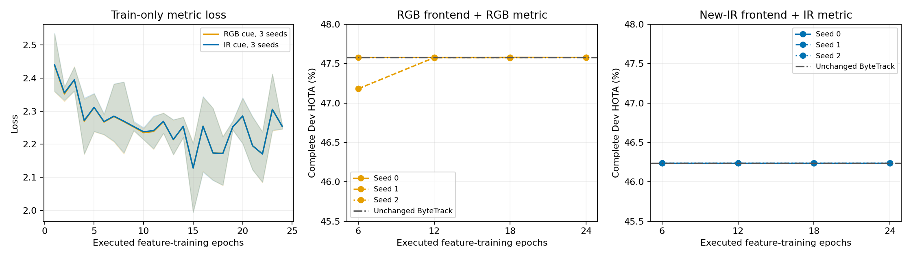

# Complete calibration and ordinary metric controls

20 graph-preserving calibration controls plus 36 matched metric Dev snapshots. No Test selection. These are ordinary controls, not established innovations.

All six metric heads executed 24 epochs, with identical schedules and seeds 0/1/2 on physical GPUs 2/3. The common stopping rule compares best Dev through24 with best through12. All six improvements are at most 0.003 HOTA points, below the registered 0.2 threshold. No Test score entered stopping or selection. These are feature-head epochs, not detector fine-tuning epochs.

RGB selected epochs are 18/24/18; IR selected epochs are 6/6/6 because all its Dev HOTA snapshots tie. Earliest checkpoint wins ties. A selected early epoch does not mean the other epochs were skipped. The same selected RGB head is retained on RGB and new-IR proposal streams for a controlled comparison.

| Calibration candidate | HOTA | DetA | AssA | IDF1 | MOTA | IDSW |
| --- | ---: | ---: | ---: | ---: | ---: | ---: |
| S00_new_zero_cue_parity | 46.236 | 68.766 | 31.137 | 53.119 | 90.224 | 108 |
| S01_new_raw_ranking | 46.236 | 68.766 | 31.137 | 53.119 | 90.224 | 108 |
| S02_new_center_ranking | 44.979 | 68.784 | 29.465 | 51.116 | 90.254 | 111 |
| S03_new_PCA_ranking | 44.898 | 68.787 | 29.359 | 51.129 | 90.276 | 112 |
| S04_new_IRmask_center | 44.499 | 68.831 | 28.824 | 49.940 | 90.258 | 109 |
| S05_new_RGBmask_center | 44.880 | 68.787 | 29.335 | 50.822 | 90.248 | 112 |
| S06_new_IRmask_PCA | 43.358 | 68.814 | 27.373 | 48.427 | 90.319 | 108 |
| S07_new_RGBmask_PCA | 44.761 | 68.786 | 29.180 | 50.837 | 90.274 | 114 |
| S08_RGB_PCA_control | 47.369 | 68.468 | 32.807 | 55.871 | 90.159 | 97 |
| S09_RGB_RGBmask_PCA_control | 47.584 | 68.788 | 32.952 | 55.862 | 90.192 | 98 |
| S10_new_Fisher_ranking | 45.004 | 68.722 | 29.526 | 50.826 | 90.252 | 112 |
| S11_new_RGBmask_Fisher | 44.872 | 68.781 | 29.328 | 50.824 | 90.246 | 111 |
| S12_new_IRmask_Fisher | 45.004 | 68.723 | 29.526 | 50.829 | 90.239 | 112 |
| S13_RGB_Fisher_control | 47.459 | 68.460 | 32.936 | 55.874 | 90.192 | 96 |
| S14_new_PCA_weak_ranking | 44.976 | 68.781 | 29.463 | 51.116 | 90.261 | 109 |
| S15_new_PCA_strong_ranking | 43.874 | 68.830 | 28.024 | 49.187 | 90.308 | 111 |
| S16_new_IRshape_PCA | 43.445 | 68.820 | 27.481 | 48.427 | 90.321 | 107 |
| S17_new_RGBshape_PCA_control | 44.279 | 68.833 | 28.540 | 49.661 | 90.278 | 112 |
| S18_new_IR_PCA_protected | 43.192 | 68.808 | 27.168 | 48.429 | 90.314 | 108 |
| S19_new_RGB_PCA_protected_control | 43.991 | 68.822 | 28.177 | 49.539 | 90.276 | 111 |

Original RGB Dev HOTA is 47.579; new-IR Dev is 46.236. The strongest ordinary RGB calibration reaches 47.584 (+0.005), which is not meaningful evidence for a new multimodal contribution. No new-input calibration exceeds the original new-input control.

| Metric cue / frontend | Seed | HOTA e06 | e12 | e18 | e24 |
| --- | ---: | ---: | ---: | ---: | ---: |
| M_rgb_rgb | 0 | 47.577 | 47.577 | 47.580 | 47.579 |
| M_rgb_rgb | 1 | 47.182 | 47.575 | 47.575 | 47.577 |
| M_rgb_rgb | 2 | 47.181 | 47.577 | 47.579 | 47.579 |
| M_new_rgb | 0 | 46.236 | 46.236 | 46.237 | 46.237 |
| M_new_rgb | 1 | 46.236 | 46.236 | 46.236 | 46.237 |
| M_new_rgb | 2 | 46.236 | 46.236 | 46.236 | 46.237 |
| M_new_ir | 0 | 46.236 | 46.236 | 46.236 | 46.236 |
| M_new_ir | 1 | 46.236 | 46.236 | 46.236 | 46.236 |
| M_new_ir | 2 | 46.236 | 46.236 | 46.236 | 46.236 |

Training loss falls, but that does not establish tracking improvement. The graph-preserving backend has few decisions changed by these learned descriptors, and IR-guided appearance does not distinguish identities better on the complete Dev set.

Full official headline/per-sequence fields, source hashes, all six loss curves and the stopping decision are in the adjacent JSON. The historical Test was exposed before this campaign and the original RGB pretraining included present Dev videos; results must remain exploratory.
