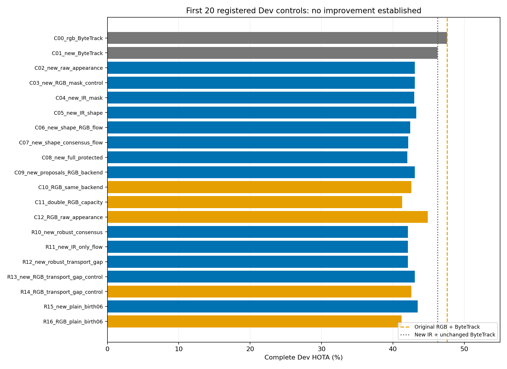

# First registered perceptual MFT Dev screen

COMPLETE_FIRST_DEV_SCREEN_GOAL_NOT_MET

Dev screening only. No new Test accuracy or supported innovation claim. Each row includes all headline fields and official per-sequence values.

| Candidate | HOTA | DetA | AssA | IDF1 | MOTA | IDSW | HOTA vs RGB |
| --- | ---: | ---: | ---: | ---: | ---: | ---: | ---: |
| C00_rgb_ByteTrack | 47.579 | 68.864 | 32.908 | 55.865 | 90.200 | 94 | +0.000 |
| C01_new_ByteTrack | 46.236 | 68.766 | 31.137 | 53.119 | 90.224 | 108 | -1.343 |
| C02_new_raw_appearance | 43.052 | 68.517 | 27.102 | 52.079 | 89.936 | 114 | -4.527 |
| C03_new_RGB_mask_control | 43.052 | 68.517 | 27.102 | 52.079 | 89.936 | 114 | -4.527 |
| C04_new_IR_mask | 42.960 | 68.090 | 27.156 | 51.564 | 89.929 | 115 | -4.619 |
| C05_new_IR_shape | 43.267 | 67.252 | 27.890 | 51.791 | 89.908 | 115 | -4.312 |
| C06_new_shape_RGB_flow | 42.426 | 67.756 | 26.613 | 50.745 | 89.903 | 111 | -5.153 |
| C07_new_shape_consensus_flow | 42.113 | 67.326 | 26.391 | 50.324 | 89.961 | 114 | -5.466 |
| C08_new_full_protected | 42.021 | 67.967 | 26.028 | 50.380 | 89.981 | 110 | -5.558 |
| C09_new_proposals_RGB_backend | 43.051 | 67.395 | 27.554 | 51.003 | 89.899 | 112 | -4.528 |
| C10_RGB_same_backend | 42.579 | 66.719 | 27.216 | 51.673 | 89.406 | 131 | -5.000 |
| C11_double_RGB_capacity | 41.296 | 67.213 | 25.416 | 48.615 | 89.398 | 129 | -6.283 |
| C12_RGB_raw_appearance | 44.874 | 67.153 | 30.020 | 53.696 | 89.423 | 126 | -2.705 |
| R10_new_robust_consensus | 42.109 | 67.263 | 26.412 | 50.380 | 89.981 | 112 | -5.470 |
| R11_new_IR_only_flow | 42.077 | 68.190 | 26.005 | 51.384 | 89.940 | 110 | -5.502 |
| R12_new_robust_transport_gap | 42.107 | 67.264 | 26.409 | 50.369 | 89.959 | 112 | -5.472 |
| R13_new_RGB_transport_gap_control | 43.050 | 67.394 | 27.553 | 50.992 | 89.873 | 112 | -4.529 |
| R14_RGB_transport_gap_control | 42.574 | 66.711 | 27.212 | 51.664 | 89.382 | 132 | -5.005 |
| R15_new_plain_birth06 | 43.451 | 68.282 | 27.688 | 51.751 | 89.983 | 122 | -4.128 |
| R16_RGB_plain_birth06 | 41.214 | 67.181 | 25.314 | 48.339 | 89.148 | 157 | -6.365 |

All 20 Dev experiments completed. No non-control candidate beats the original RGB control. Ordinary appearance, memory or threshold changes receive no multimodal contribution credit.

The new-input C02 custom backend changes primary/secondary assignment and lifecycle: its age limit is 30 frames, whereas the original ByteTrack buffer is scaled to int(25/30*30)=25. These are experimental backend changes, not isolated modality effects. The next family keeps the original lifecycle and rejection graph.

Full headline/per-sequence fields, hashes and source versions are in the adjacent JSON. Historical Test remains excluded from selection.
