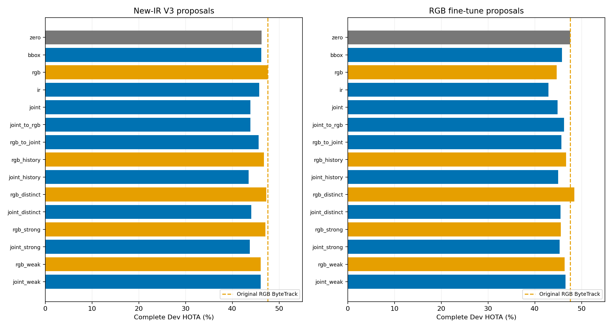

# Complete foreground point Dev screen

Complete4,834-frame Dev screen, not Test. Single-lag geometric point transport and multi-lag/co-visible memory controls. Ordinary point tracking and generic memory are not by themselves new multimodal contributions.

| Candidate | HOTA | DetA | AssA | IDF1 | MOTA | IDSW | Duplicate vetoes |
| --- | ---: | ---: | ---: | ---: | ---: | ---: | ---: |
| P_new_00_zero | 46.236 | 68.766 | 31.137 | 53.119 | 90.224 | 108 | 0 |
| P_new_01_bbox | 46.180 | 68.332 | 31.262 | 54.516 | 90.358 | 102 | 0 |
| P_new_02_rgb | 47.608 | 68.423 | 33.172 | 56.288 | 90.289 | 98 | 0 |
| P_new_03_ir | 45.755 | 68.084 | 30.800 | 52.757 | 90.319 | 108 | 0 |
| P_new_04_joint | 43.894 | 68.071 | 28.358 | 50.838 | 90.325 | 106 | 0 |
| P_new_05_joint_to_rgb | 43.898 | 68.136 | 28.328 | 50.484 | 90.390 | 102 | 0 |
| P_new_06_rgb_to_joint | 45.638 | 68.240 | 30.569 | 52.573 | 90.295 | 103 | 0 |
| P_new_07_rgb_history | 46.738 | 68.381 | 31.991 | 53.158 | 90.190 | 102 | 0 |
| P_new_08_joint_history | 43.508 | 68.566 | 27.665 | 49.957 | 90.250 | 106 | 0 |
| P_new_09_rgb_distinct | 47.285 | 68.580 | 32.649 | 53.911 | 90.215 | 100 | 2 |
| P_new_10_joint_distinct | 44.080 | 68.758 | 28.317 | 50.701 | 90.265 | 106 | 2 |
| P_new_11_rgb_strong | 47.087 | 68.550 | 32.388 | 53.442 | 90.203 | 100 | 0 |
| P_new_12_joint_strong | 43.741 | 68.517 | 27.977 | 49.818 | 90.258 | 106 | 0 |
| P_new_13_rgb_weak | 46.052 | 68.554 | 30.988 | 52.425 | 90.209 | 104 | 0 |
| P_new_14_joint_weak | 46.072 | 68.756 | 30.924 | 52.274 | 90.190 | 103 | 0 |
| P_rgb_00_zero | 47.579 | 68.864 | 32.908 | 55.865 | 90.200 | 94 | 0 |
| P_rgb_01_bbox | 45.789 | 68.772 | 30.526 | 53.531 | 90.226 | 93 | 0 |
| P_rgb_02_rgb | 44.661 | 68.771 | 29.042 | 52.234 | 90.144 | 97 | 0 |
| P_rgb_03_ir | 42.921 | 68.819 | 26.814 | 49.903 | 90.209 | 96 | 0 |
| P_rgb_04_joint | 44.889 | 68.738 | 29.355 | 52.466 | 90.226 | 96 | 0 |
| P_rgb_05_joint_to_rgb | 46.247 | 68.881 | 31.089 | 55.047 | 90.271 | 97 | 0 |
| P_rgb_06_rgb_to_joint | 45.664 | 68.692 | 30.394 | 52.763 | 90.168 | 91 | 0 |
| P_rgb_07_rgb_history | 46.676 | 68.789 | 31.707 | 54.490 | 90.250 | 92 | 0 |
| P_rgb_08_joint_history | 44.991 | 68.648 | 29.528 | 52.745 | 90.211 | 95 | 0 |
| P_rgb_09_rgb_distinct | 48.486 | 68.794 | 34.205 | 57.532 | 90.254 | 89 | 2 |
| P_rgb_10_joint_distinct | 45.519 | 68.640 | 30.227 | 53.499 | 90.207 | 94 | 1 |
| P_rgb_11_rgb_strong | 45.562 | 68.697 | 30.259 | 53.457 | 90.140 | 100 | 0 |
| P_rgb_12_joint_strong | 45.317 | 68.638 | 29.964 | 52.085 | 90.220 | 97 | 0 |
| P_rgb_13_rgb_weak | 46.413 | 68.826 | 31.334 | 54.132 | 90.237 | 90 | 0 |
| P_rgb_14_joint_weak | 46.551 | 68.701 | 31.578 | 53.950 | 90.248 | 93 | 0 |

The zero-point wrappers exactly reproduce every official field for both original frontends. The strongest RGB-only point/memory control is 48.486 HOTA (+0.907 over47.579). That gain is generic tracking evidence, not evidence for pseudo-IR fusion.

On new-IR V3 proposals, RGB body points reach47.608 versus46.236 for unchanged ByteTrack, while hard joint IR/RGB point selection falls to43.894. Source-only and target-only controls show that restricting the source points is especially harmful. Multi-lag averaging also does not consistently beat the latest observation. Previously co-visible memory prevents two duplicate deletions in each corresponding full variant; aggregate effects still require complete Test validation.

The offline diagnostic maps proposals to Dev GT only after the independent point producer finishes. Adjacent-frame confident correspondence precision is about98.5%; the confidence>=0.7 subset is about99.2–99.4%. These are proposal evidence diagnostics, not official identity switches or proof of tracking improvement. Even a small number of wrong links can fragment a long identity.

The next registered family keeps RGB source points, uses IR only for an ownership increment under RGB uncertainty, requires agreement across earlier observations, and compares supported low-score candidate births with an ordinary global0.6 birth threshold. It also tests whether clear original motion associations should be preserved. No new Test result selects these rules.

All headline/per-sequence fields, extraction paths/hashes and raw evidence diagnosis are retained in the adjacent JSON. Caches and input images remain outside Git.
