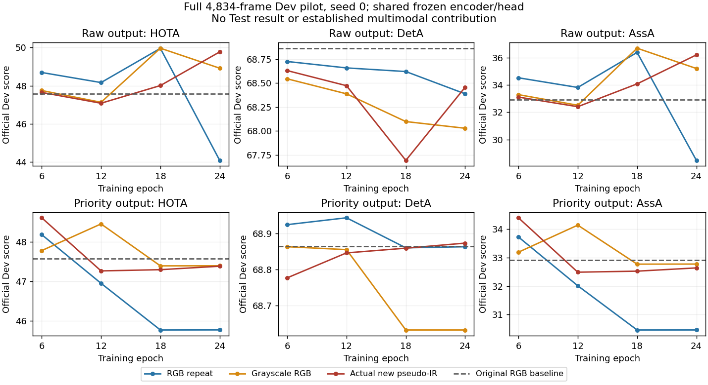

# Shared frozen-encoder correlation pilot

Full4834-frame Dev, not Test. All registered rows and failures retained. Cached replay speed excludes pixel/encoder preparation and is not end-to-end FPS.

All25 full Dev cases completed; best actual IR49.771 does not beat strongest matched RGB49.957 or gray49.965. IR improvement over original47.579 is insufficient to establish modality contribution. No new Test or supported innovation. Conditional registered recoverability repair is activated from complete Dev evidence.

Detection accuracy changes little while association accuracy varies strongly.
Preserving original high-confidence observations in the final union does not
guarantee preserved track identities: promoted weak candidates can change
the matching graph. The raw and priority results are therefore both retained.

The separate posthoc IoU0.5 identity-event audit finds89/114 baseline
identity changes after a missed match. BT has31 changes,30 near another GT
box with IoU>=0.1; SN has83 changes, including31 after gaps longer than25
frames. These diagnostic events are not official IDSW and box overlap is
only an occlusion proxy. The actual-IR selected output has133 such events,
so its higher HOTA must not be described as fewer diagnostic identity changes.
The accompanying audit retains every GT identity's fragmentation statistics.

| Candidate | HOTA | DetA | AssA | IDF1 | MOTA | IDSW | Old-ID weak recoveries | New candidate births |
| --- | ---: | ---: | ---: | ---: | ---: | ---: | ---: | ---: |
| CGA_gray_full_s0_e06 | 47.785 | 68.863 | 33.191 | 56.132 | 90.256 | 93 | 0 | 0 |
| CGA_gray_full_s0_e06_raw | 47.747 | 68.544 | 33.294 | 55.863 | 89.824 | 96 | 0 | 0 |
| CGA_gray_full_s0_e12 | 48.461 | 68.855 | 34.140 | 55.805 | 90.157 | 94 | 0 | 0 |
| CGA_gray_full_s0_e12_raw | 47.130 | 68.387 | 32.515 | 53.661 | 89.772 | 100 | 0 | 0 |
| CGA_gray_full_s0_e18 | 47.397 | 68.633 | 32.771 | 53.653 | 90.017 | 99 | 0 | 0 |
| CGA_gray_full_s0_e18_raw | 49.965 | 68.097 | 36.707 | 58.417 | 89.311 | 113 | 0 | 0 |
| CGA_gray_full_s0_e24 | 47.399 | 68.633 | 32.774 | 53.651 | 90.005 | 99 | 0 | 0 |
| CGA_gray_full_s0_e24_raw | 48.917 | 68.027 | 35.215 | 57.264 | 89.290 | 115 | 0 | 0 |
| CGA_ir_full_s0_e06 | 48.617 | 68.777 | 34.398 | 56.548 | 90.211 | 91 | 0 | 0 |
| CGA_ir_full_s0_e06_raw | 47.646 | 68.630 | 33.115 | 55.831 | 90.041 | 90 | 0 | 0 |
| CGA_ir_full_s0_e12 | 47.269 | 68.846 | 32.489 | 54.325 | 90.132 | 95 | 0 | 0 |
| CGA_ir_full_s0_e12_raw | 47.081 | 68.472 | 32.409 | 54.374 | 89.751 | 91 | 0 | 0 |
| CGA_ir_full_s0_e18 | 47.300 | 68.859 | 32.525 | 54.339 | 90.104 | 95 | 0 | 0 |
| CGA_ir_full_s0_e18_raw | 48.007 | 67.691 | 34.085 | 56.902 | 89.906 | 92 | 0 | 0 |
| CGA_ir_full_s0_e24 | 47.388 | 68.873 | 32.639 | 54.337 | 90.108 | 96 | 0 | 0 |
| CGA_ir_full_s0_e24_raw | 49.771 | 68.456 | 36.217 | 59.972 | 89.884 | 88 | 0 | 0 |
| CGA_original_RGB_ByteTrack | 47.579 | 68.864 | 32.908 | 55.865 | 90.200 | 94 | 0 | 0 |
| CGA_rgb_full_s0_e06 | 48.189 | 68.924 | 33.724 | 56.528 | 90.159 | 89 | 0 | 0 |
| CGA_rgb_full_s0_e06_raw | 48.692 | 68.725 | 34.533 | 57.087 | 89.996 | 88 | 0 | 0 |
| CGA_rgb_full_s0_e12 | 46.954 | 68.943 | 32.013 | 53.077 | 90.056 | 92 | 0 | 0 |
| CGA_rgb_full_s0_e12_raw | 48.164 | 68.658 | 33.822 | 55.771 | 89.890 | 97 | 0 | 0 |
| CGA_rgb_full_s0_e18 | 45.770 | 68.860 | 30.461 | 51.951 | 90.093 | 100 | 0 | 0 |
| CGA_rgb_full_s0_e18_raw | 49.957 | 68.620 | 36.397 | 58.252 | 90.080 | 96 | 0 | 0 |
| CGA_rgb_full_s0_e24 | 45.772 | 68.863 | 30.462 | 51.953 | 90.106 | 100 | 0 | 0 |
| CGA_rgb_full_s0_e24_raw | 44.085 | 68.387 | 28.463 | 48.683 | 89.970 | 96 | 0 | 0 |

No current Dev family establishes the original >=+5 Test HOTA and2-3 independent contribution objective. Full metric fields, per-sequence values, configuration hashes and exact runtime source versions are in the adjacent JSON.

Classical threshold changes, generic memory and ordinary supervised heads receive no multimodal novelty credit alone. Historical Test was exposed before this campaign; original RGB pretraining also included present Dev videos.
