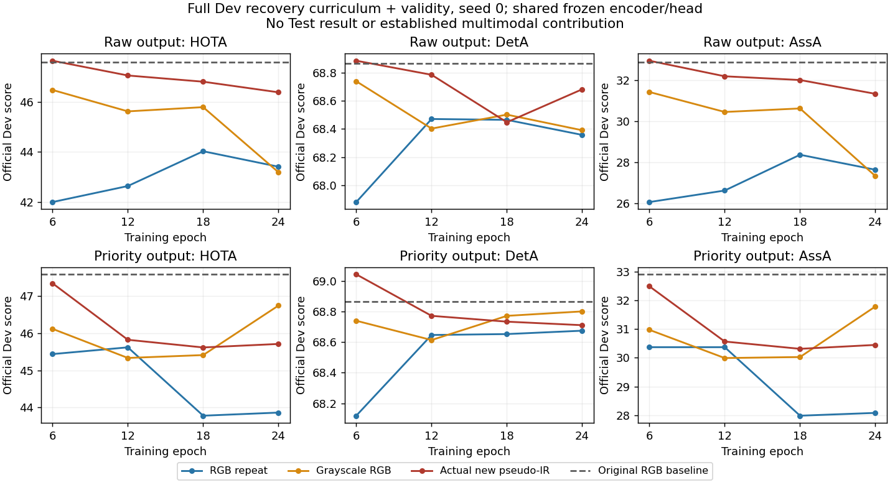

# Recoverability curriculum and class-validity pilot

Full4834-frame Dev, not Test. All registered rows and failures retained. Cached replay speed excludes pixel/encoder preparation and is not end-to-end FPS.

All25 full Dev cases complete. BestIR47.628 exceeds matched-curriculum gray46.740 and RGB45.617, but only+0.049 over original47.579 and below earlier strongRGB49.957/gray49.965 and earlierIR49.771. The repair degrades the best result; it establishes no new contribution. Continue all registered removals, no Test.

The relative IR advantage within this new training regime accompanies a
degradation of both matched controls. It is not an improvement over the
strongest earlier RGB/gray solutions. All24 epochs completed; epoch6 is the
best selected IR checkpoint among all4 registered snapshots, not an early stop.

| Candidate | HOTA | DetA | AssA | IDF1 | MOTA | IDSW | Old-ID weak recoveries | New candidate births |
| --- | ---: | ---: | ---: | ---: | ---: | ---: | ---: | ---: |
| CGR_gray_full_s0_e06 | 46.114 | 68.739 | 30.975 | 51.197 | 89.841 | 98 | 0 | 0 |
| CGR_gray_full_s0_e06_raw | 46.466 | 68.738 | 31.436 | 53.492 | 89.494 | 111 | 0 | 0 |
| CGR_gray_full_s0_e12 | 45.332 | 68.613 | 29.993 | 51.545 | 89.751 | 109 | 0 | 0 |
| CGR_gray_full_s0_e12_raw | 45.615 | 68.402 | 30.459 | 53.253 | 89.382 | 121 | 0 | 0 |
| CGR_gray_full_s0_e18 | 45.409 | 68.771 | 30.028 | 51.473 | 89.826 | 111 | 0 | 0 |
| CGR_gray_full_s0_e18_raw | 45.783 | 68.501 | 30.631 | 53.057 | 89.305 | 141 | 0 | 0 |
| CGR_gray_full_s0_e24 | 46.740 | 68.800 | 31.788 | 53.340 | 89.720 | 113 | 0 | 0 |
| CGR_gray_full_s0_e24_raw | 43.195 | 68.390 | 27.324 | 48.846 | 89.066 | 139 | 0 | 0 |
| CGR_ir_full_s0_e06 | 47.338 | 69.042 | 32.491 | 54.316 | 90.196 | 94 | 0 | 0 |
| CGR_ir_full_s0_e06_raw | 47.628 | 68.884 | 32.967 | 54.495 | 90.198 | 98 | 0 | 0 |
| CGR_ir_full_s0_e12 | 45.820 | 68.771 | 30.568 | 53.583 | 90.060 | 103 | 0 | 0 |
| CGR_ir_full_s0_e12_raw | 47.041 | 68.784 | 32.205 | 54.878 | 89.946 | 108 | 0 | 0 |
| CGR_ir_full_s0_e18 | 45.614 | 68.733 | 30.314 | 52.790 | 90.024 | 102 | 0 | 0 |
| CGR_ir_full_s0_e18_raw | 46.794 | 68.447 | 32.023 | 54.996 | 89.953 | 105 | 0 | 0 |
| CGR_ir_full_s0_e24 | 45.708 | 68.710 | 30.450 | 53.101 | 90.009 | 105 | 0 | 0 |
| CGR_ir_full_s0_e24_raw | 46.373 | 68.681 | 31.347 | 54.449 | 89.921 | 103 | 0 | 0 |
| CGR_original_RGB_ByteTrack | 47.579 | 68.864 | 32.908 | 55.865 | 90.200 | 94 | 0 | 0 |
| CGR_rgb_full_s0_e06 | 45.436 | 68.119 | 30.371 | 47.756 | 89.299 | 124 | 0 | 0 |
| CGR_rgb_full_s0_e06_raw | 42.011 | 67.880 | 26.050 | 43.129 | 88.399 | 180 | 0 | 0 |
| CGR_rgb_full_s0_e12 | 45.617 | 68.646 | 30.371 | 48.803 | 89.680 | 118 | 0 | 0 |
| CGR_rgb_full_s0_e12_raw | 42.648 | 68.470 | 26.614 | 45.764 | 89.215 | 152 | 0 | 0 |
| CGR_rgb_full_s0_e18 | 43.780 | 68.652 | 27.985 | 47.078 | 89.763 | 120 | 0 | 0 |
| CGR_rgb_full_s0_e18_raw | 44.030 | 68.464 | 28.365 | 47.412 | 89.208 | 147 | 0 | 0 |
| CGR_rgb_full_s0_e24 | 43.863 | 68.674 | 28.082 | 47.103 | 89.802 | 118 | 0 | 0 |
| CGR_rgb_full_s0_e24_raw | 43.416 | 68.357 | 27.632 | 45.030 | 89.111 | 153 | 0 | 0 |

No current Dev family establishes the original >=+5 Test HOTA and2-3 independent contribution objective. Full metric fields, per-sequence values, configuration hashes and exact runtime source versions are in the adjacent JSON.

Classical threshold changes, generic memory and ordinary supervised heads receive no multimodal novelty credit alone. Historical Test was exposed before this campaign; original RGB pretraining also included present Dev videos.
