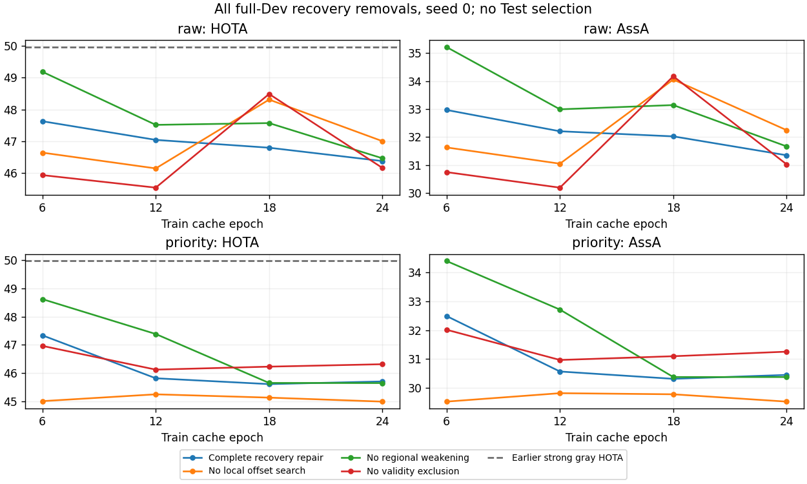

# Recovery removals: all32 registered policies

Seed0 only. All4 checkpoints and raw/priority policies. Dev-only best-grid removal comparisons, not three-seed contributions or Test accuracy.

| Removed mechanism | Best removal HOTA | Full minus removal |
| --- | ---: | ---: |
| aligned | 48.310 | -0.682 |
| no_curriculum | 49.186 | -1.558 |
| blanket_counterfactual | 48.487 | -0.859 |

Full recovery best HOTA is47.628. Earlier parent IR49.771 and strongest gray49.965 remain required controls.
Negative or neutral removal deltas do not support a contribution. No new Test result or established innovation is asserted.
