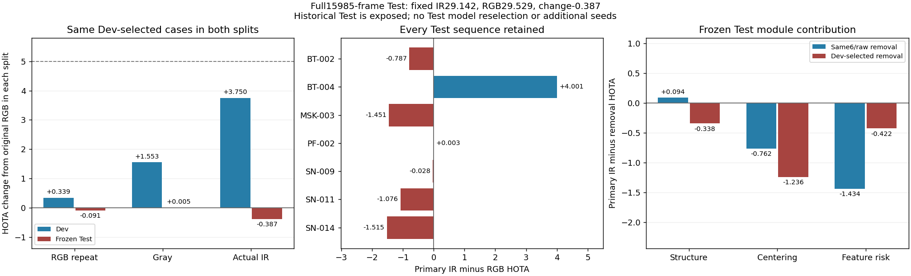
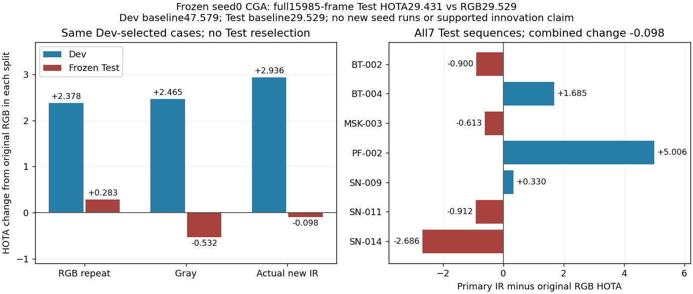

# 新版伪红外 MFT：研究进展与结论

更新时间：2026-11-25（北京时间）。任务仍在执行，目标尚未完成。

最新核对：有局部正向结果，尚无经过完整公平对照和消融支持的独立多模态
创新。完整七段Test最高观测31.504，对原始RGB29.529为+1.975点；对应
RGB对照31.440，IR差值仅+0.064。这个最高观测不是按Test新选出的主方法。
旧结构方案按Dev固定的主模型Test29.142，仍低于原始RGB0.387点；
另一分支Test+1.022而Dev−1.800，尚不能作为稳定贡献。目标34.529及
2–3项独立贡献均未达到；详见[NATIVE_REMAINING_ASSESSMENT](PERCEPTUAL_MFT_20261124_NATIVE_REMAINING_ASSESSMENT.md)。

六组匹配全量Train已完成四组；IR101／110已核验48/72宏循环、各两遍
完整27251帧Train，原PID158984／159108继续在物理4／5卡执行第三遍。
每组13824次更新、55296次输入访问，48份实际交付地址摘要全部匹配。
24宏循环才是一遍，不能写成48轮完整数据。见
[IR_REMAINING_SECOND_FULL_TRAIN_AUDIT](PERCEPTUAL_MFT_20261125_IR_REMAINING_SECOND_FULL_TRAIN_AUDIT.md)。
本轮没有新的候选Dev/Test准确率。质量、空间、因果时序与轨迹记忆仍是
待验证的机制；代码和工程检查不计作创新。

新增六段Train／66帧的当前与过去辅助输入诊断已完成，三个同预算完整
模型全部保留。固定0.6下原RGB支持680、当前IR671、过去IR682；当前IR
在六段均未有更高支持量。0.1下当前IR比过去多2但与RGB持平；0.7下比
RGB少10。IR对前景／背景的差值排序AUC0.493933，RGB0.509339，不能把
平均分数变化当作有用互补。992个GT观测中50个没有足够几何重叠的原RGB
解码锚点，纯分数修改不能恢复本诊断定义的支持。后续继续已登记的任务
相关空间选择、可学习表征及几何检验，不追加该结构路线超参搜索；这不是
新HOTA或泛化证明。CPU904.312秒、RSS1.107GiB，无拟合或新缓存。见
[TRAIN_CUE_SPECIFICITY](PERCEPTUAL_MFT_20261125_TRAIN_CUE_SPECIFICITY.md)。

F4完整调度器、生产／评估／独立测速／导出现已接通。95项CPU检查通过，
锁定384项来源并登记；实际CPU控制器488189已确认等待空间前序完整导出
和原进程实际退出，当前phases为空。真实CPU预检没有读取张量、图像、
指标或GT，没有调用CUDA；六个父模型标记仍缺，实际父模型资格未知。
真实GPU检查、学习融合特征转移、正式F4准确率尚未执行；旧CPU摘要异常
原因仍未解决。不能把本轮工程完成计作HOTA提升或方向验证完成。见
[F4_FULL_WORKFLOW](PERCEPTUAL_MFT_20261125_F4_FULL_WORKFLOW.md)。

九份旧登记、空间323来源／11依赖、测速137动态来源均精确不变；原训练
未修改或重启。审计时工作文件58.237GiB，上限64GiB；固定seed0，仍只
允许物理4／5卡、最多两卡。最新诊断后工作文件58.238GiB，图表仅留工作盘；
Git保留代码、文本结果和分析。Goal active，已验证独立贡献0。

以下保留历次进展记录，其中尚待事项和进度以以上最新状态为准。

F4实际GPU工程入口与独立NN/ByteTrack/记忆比较器已实现，19项人工
检查通过。两份原RGB CPU模型在固定Train前8帧完成16次NN前向、109个ROI
的实际核对，全部检测源/零MOT/KF/ID/保留记忆精确，CPU92.194秒／
RSS1.929GiB；两个非零配置各21条正惩罚边，短片段MOT仍未变。
旧CPU摘要异常原因仍未知，不称修复；新差异记录会包含配置/帧号/数值差。
GPU资格、真实IR父模型、完整Dev/Test仍待实际完成，无新HOTA或独立贡献。
IR101／110仍在4／5卡第39／39宏循环，九份登记/原进程/队列未改。调度与
最终导出两入口仍缺，完整F4未登记；见[F4_GPU_ENGINEERING_COMPONENTS](PERCEPTUAL_MFT_20261125_F4_GPU_ENGINEERING_COMPONENTS.md)。

F4独立测速组件和逐条件入口已实现，23项人工检查通过；原生无逐帧
前缀的来源兼容已按实际产物处理。初次真实Train RGB八帧、两配置各独立
验证/计时精确匹配旧参照，CPU131.155秒／RSS1.547GiB；但更新后重跑出现
检测摘要不一致，退出1。后续原检测器与零记忆八帧诊断完全复现旧参照，
仍未找到异常原因，不称已修复，不放宽核验或放行GPU资格。详见
[F4_RUNTIME_COMPONENTS](PERCEPTUAL_MFT_20261125_F4_RUNTIME_COMPONENTS.md)及原失败日志。
当前IR101／110仍在4／5卡第35／35宏循环，原进程、九份登记和队列未改；
本轮无新Dev/Test、学习融合转移或准确率，独立创新仍0。GPU工程、调度和
导出三入口仍缺，父模型六标记待生成，Goal active。

最新问答核对：有局部正向结果，但证据完整的独立多模态创新仍为0。
完整七段Test最高观测31.504，相比原始RGB29.529为+1.975；匹配RGB31.440，
IR增量仅+0.064。另一分支Test+1.022而Dev−1.800，目标34.529尚未达到。
六组全量Train已完成四组，IR101／110仍在4／5卡第31／31宏循环，第二遍中；
24宏循环才是一遍完整27251帧，预算72宏循环／三遍，本轮无新Dev/Test。

F4执行上下文及生产入口部分实现，17项组件检查通过；实际CPU主入口
preflight在加载张量／图像／GT／CUDA前返回等待，六个父模型标记缺失，
资格未知。GPU工程／成本／调度／导出仍缺，未完整登记或新GPU启动。
九份旧登记和原训练均未改，见[F4_WORKFLOW_CONTEXT](PERCEPTUAL_MFT_20261125_F4_WORKFLOW_CONTEXT.md)。

IR101／110现已各核验第一遍完整27251帧Train：一致快照各完成25宏循环、
7200更新、28800访问，全部实际交付地址摘要匹配日程。首24宏循环覆盖
六段全部帧，第25已进入第二遍；预算仍72宏循环／三遍，不是六组已完成。
4／5卡当前日志到27宏循环，健康训练未改，无新Dev/Test HOTA；见
[IR_REMAINING_FIRST_FULL_TRAIN_AUDIT](PERCEPTUAL_MFT_20261125_IR_REMAINING_FIRST_FULL_TRAIN_AUDIT.md)。

F4官方评估与Dev文件冻结组件已补齐，10项人工完整文件检查通过；已有
RGB完整4834帧Dev再次执行原官方评估，39摘要、47字段逐序列／汇总和
整个276列CSV均精确一致。已有Dev HOTA47.579162是基线复核，不是新F4
或Test成绩，不计提升；CPU7.698秒／RSS0.611GiB。无真实F4选择、学习
融合特征或新候选准确率。正式GPU生产入口、完整执行／成本／调度仍待
接通，独立创新0、Goal active；见
[F4_OFFICIAL_EVALUATION](PERCEPTUAL_MFT_20261125_F4_OFFICIAL_EVALUATION.md)。

本轮补齐F4严格CPU加载和序列交付组件：20项未训练张量检查、8项人工
交付检查通过。真实父模型入口因六个未来标记缺失，在读取融合张量前
返回等待；单独原RGB加载98,995,378参数成功，CPU6.578秒／RSS1.547GiB。
固定Train前八帧的源图像交付及三个RGB记忆配置均匹配既有独立参照，
CPU40.596秒／RSS1.545GiB；IR八文件只核对字节，未解码或进入算法。
正式Dev/Test截短与失败不能生成完整记录；八帧仅为243帧序列的工程前缀。
无新HOTA、真实融合张量加载或创新贡献。4／5卡IR101／110到23/72宏循环，
原训练与九份登记均未改。正式GPU生产入口、完整评估／成本／调度仍待
接通；见[F4_LOADING_DELIVERY](PERCEPTUAL_MFT_20261125_F4_LOADING_DELIVERY.md)。

F4在线内存执行组件与最终MOT写盘已接通：14项集成检查通过；固定真实
Train RGB前八连续帧、109个实际P3 ROI，零／0.05／0.1检测包、ROI、
KF／ID／保留记忆和MOT均与独立参照一致。两个非零权重各25次记忆更新、
21条正外观惩罚边，但短片段MOT仍与ByteTrack相同，没有新准确率。
旧轨迹已消费观测引用的释放经44帧人工与八帧真实数据核对，数学行为
未变。CPU88.154秒、峰值RSS1.224GiB，无新GPU／拟合／盘特征缓存。
IR101／110原进程均已完成20/72宏循环，完整Dev/Test仍待原定训练。
正式F4的实际合格父模型、严格加载、GPU门槛、完整生产／评估／成本
与队列尚待补齐，独立创新计数仍0；见
[F4_ONLINE_ENGINEERING](PERCEPTUAL_MFT_20261125_F4_ONLINE_ENGINEERING.md)。

本次最新核对：六组全量拟合已完成四组，IR101／110分别仍在物理4／5卡，
均为19/72宏循环、step64/288；本轮仍无新的Dev/Test HOTA。正向证据
仍是最高观测31.504对原始RGB29.529为+1.975，但对匹配RGB31.440只高
0.064；另一身份分支Test比匹配RGB高1.022，Dev却低1.800。尚无完善、
可独立归因的2–3项创新，目标34.529未达，已验证独立贡献0。

F4父模型实际文件核验代码现已实现：22项人工文件检查，加原有25项纯
规则，共47项通过。真实目录读取退出0，但两家族六个未来完成标记均
缺失，在读取父模型Dev表／checkpoint前返回pending；资格未知，不能
算作失败或已通过。严格张量加载、完整生产执行器、评估、成本与调度仍需
接通。九份既有登记、空间323来源／11依赖及测速137动态来源均未变；
工作文件58.235GiB，无新GPU／缓存／准确率。见
[F4_PARENT_IO](PERCEPTUAL_MFT_20261125_F4_PARENT_IO.md)。

F4普通RGB控制的真实非零路径现已补查：五段独立连续Train片段共20帧，
268个实际RGB P3 ROI向量；0.05／0.1各47次可靠更新及34次正外观惩罚。
零权重逐帧状态及MOT精确等于原ByteTrack，非零权重在本批短片段的MOT
也均未变，不能据此宣称收益。CPU25.211秒、峰值RSS0.968GiB，没有
读取GT或Dev/Test，没有加载融合模型或新增GPU。见
[F4_REAL_RGB_ENGINEERING](PERCEPTUAL_MFT_20261125_F4_REAL_RGB_ENGINEERING.md)。

F4正式科学设计及纯选择规则已实现，25项合成记录检查通过；最多48项
正常记忆配置，必要去阈值与干预后最多78项完整Test，不新增NN拟合。
去阈值的缺失路径须匹配相同阈值RGB控制；初始设计原字节保留为修订依据。
父模型文件核验代码已补齐，真实完整曲线尚待生成；在线执行器、评估与成本流程仍待补齐，
没有正式F4排队或学习融合特征转移。纯规则不证明父模型资格或创新；见
[FUSION_MEMORY_DESIGN](PERCEPTUAL_MFT_20261125_FUSION_MEMORY_DESIGN.md)。

最新机制诊断已完成并保留全部条件：原23组配对在完整Dev上有7组汇总
HOTA为正、4组两段均正、9组方向反转；两段同时胜过RGB及自身关闭的
仍为0。NR36在BT-005比RGB低7.245584，主要为AssA下降9.916235；
SN-013则高2.598175。完整Dev事后轨迹诊断中BT匹配观测只差9次，
但GT最大单轨占比IR53.243%、RGB64.156%，不能用IDSW只多4次概括。
见[NATIVE_DEV_DOMAINS](PERCEPTUAL_MFT_20261125_NATIVE_DEV_DOMAINS.md)及
[DEV_TRACK_CONCENTRATION](PERCEPTUAL_MFT_20261125_DEV_TRACK_CONCENTRATION.md)。

六段Train各12帧的完整视觉机制检查也已完成：四个已完成全量拟合条件，
再补IR111第一／二遍快照，共六组；5040项分域／层／区域标量全部保存，
CPU913.818秒、峰值RSS1.158GiB，无参数更新或新GPU。IR111 P3弱RGB
框内／背景置信0.332209／0.329141，逐域仅三段框内较高；修正从第一遍
0.043460增至第三遍0.061386，但固定0.6稠密锚点支持仍净减7个GT。
这是Train样本与稠密锚点诊断，不是Recall、Dev/Test HOTA或创新贡献。
见[STRUCTURAL_TRAIN_MECHANISM](PERCEPTUAL_MFT_20261125_STRUCTURAL_TRAIN_MECHANISM.md)。
六组全量训练仍完成四组，IR101/110继续在4/5卡；原Dev选择与队列未改。

最新答复：有局部正向结果，但没有证据完整的2–3项独立多模态创新。
已有完整七段Test最高观测HOTA31.504，相对原始RGB29.529为+1.975点；
对应匹配RGB为31.440，所以IR增量只有+0.064，不能把全部提升归于IR。
另一身份关联分支Test30.849对匹配RGB29.827为+1.022，但Dev41.136对
42.936为−1.800，尚不支持稳定贡献。最高观测不作为Test选出的新主模型。
目标34.529尚未达到，已验证独立贡献仍为0；完整对照见
[NATIVE_REMAINING_ASSESSMENT](PERCEPTUAL_MFT_20261124_NATIVE_REMAINING_ASSESSMENT.md)。

本轮六组全量拟合已完成RGB、灰度、IR111和IR011四组；IR101/110仍分别
在物理4/5卡运行，最新核对各完成第6/72宏循环。24个宏循环才是一遍
27251帧完整Train；这两组尚未跑完第一遍，本轮没有新的Dev/Test HOTA。
质量、空间、因果时序和融合轨迹记忆仍是待完整验证的机制假说，
不把模块实现、工程检查或loss下降计作创新贡献。

F4特征接口已补齐当前RGB／辅助／实际融合P3到候选ROI与记忆的数据路径。
15项新增检查及三类未训练模型各8帧、共24帧合成输入检查通过，峰值
RSS0.588GiB；没有读取学习权重或真实Train/Dev/Test图像，没有新增GPU、
拟合或HOTA。时序路径使用当前滤波后的辅助状态；注意力值仅为显式代理，
不是校准可靠性，未来仍须相同权重RGB及固定权重1强对照。9份既有登记、
空间流程323来源和11依赖均未变，工作文件58.233GiB，独立空闲2757.534GiB。
正式F4选择与完整比较仍待接通，不代表已传递学习到的融合特征。见
[FUSION_MEMORY_CAPTURE](PERCEPTUAL_MFT_20261125_FUSION_MEMORY_CAPTURE.md)。

下方按历次进展保留历史快照，当前进度以本段及对应原始记录为准。

用户清除旧Goal后，新Goal已重新创建且状态active，登记见
`configs/perceptual_research_goal_20261124.json`。沿用新版DiffV2IR、直接RGB
基线29.529、目标HOTA至少34.529及2–3项明确贡献；仅4/5卡、固定seed0。
新Goal建立时直接接续当时的训练与评估；后续输入保护故障及恢复见下文。

空间候选完整Train／Dev／Test／独立成本／47字段流程已登记并启动CPU
等待，323来源、九组正常条件及11依赖锁定，真实控制器184707身份核实，
阶段／子进程为空。38项不同CPU检查；实际九组worker各12帧/3更新及
两帧800×1440独立B1检查通过，峰值RSS2.637GiB。GPU另须12帧资格，
不能由CPU替代。9组均按相同6/9/12遍完整Train与Dev规则，负Dev亦完整
七Test；精确计算配方复用去除，无新增种子。仍待前序实际退出，无新
GPU／正式拟合／HOTA或创新计数。见NATIVE_SPATIAL_QUEUE及其CPU证明/
REGISTRATION/QUEUE_REGISTRATION。历史“流程未接通”保留为早期快照。

IR111/011现已完成72宏循环、三遍完整Train并通过独立终审：各20736次
更新、82944次访问，三遍各覆盖27251帧；两份54502项RGB/IR输入内容清单
逐字节相同，所有72项实际交付摘要匹配。原进程已退出，IR101/110已由
控制器自动在4/5卡接续。当前六组完成四组，尚无本轮Dev/Test HOTA。
见IR_TWO_COMPLETE_TRAIN_AUDIT。以下更早的进度数字保留为历史快照。

新增当前November IR空间融合工程原型：空间／质量+空间／再加冗余三种
开关组合，各匹配RGB／灰度／IR，10项单元检查及六段Train各一帧、九组
共54次CPU工程更新通过；初始完整head与学习后缺失模态均精确回到RGB。
峰值RSS2.058GiB，原RGB参数/BN未变，308来源及八份既有登记未变。
空间gate变化仍很小，不能据此证明有效选择或贡献；无新GPU、正式拟合、
Dev/Test或HOTA。完整正式流程仍待接通，目标active、创新计数0；
见NATIVE_SPATIAL_ENGINEERING、CPU_PROOF及ASSESSMENT。

截至2026-11-24 22:30北京时间，IR111/011两组仍在4/5卡正常训练，
日志已到第64/72宏循环；24宏循环是一遍全部27251帧Train，因此当前在
第三遍。RGB/灰度已完成，另外两组IR去除待训。本轮尚无新Dev/Test HOTA。
已有NR36完整Test30.849对匹配RGB29.827为+1.022，但Dev反低1.800；
观测最高31.504对原始29.529为+1.975，不能全归于IR，更未达到+5。
已验证独立贡献仍为0，目标active，见FOUR_DIRECTION_COVERAGE。

本轮补上真实融合P3/q到轨迹记忆所需的F4工程原型：11项CPU检查及完整
4834帧Dev零权重回放通过，原MOT字节与每帧tracked/lost/removed数值状态
均严格一致；ROI坐标/stride8检查通过，峰值RSS0.580GiB。尚未接入学习到
的融合特征，没有额外GPU、新HOTA或正式F4流程，不能计为创新或四方向
完成。八份前序源码登记全部保持一致，工作目录58.294GiB；不修改健康
训练。见FUSION_MEMORY_ENGINEERING、CPU_PROOF及SOURCE_AUDIT。

联合关闭四组归因的完整流程现已实现、登记并启动CPU等待：84项集成检查
及两个模式真实Train／独立B1检查通过，180个来源和13个依赖锁定，峰值
RSS2.542GiB。实际控制器57946处于等待前序全部完成与实际退出的状态，
阶段／子进程为空，尚无额外GPU或拟合。仍须原正常IR先通过完整Dev强
RGB／灰度条件，最多补一组00；不据Test触发，已拟合的负Dev对象仍完整
Test。官方47字段、原CSV、两策略完整精度效应及独立成本导出已接通。
见NATIVE_FACTORIAL_QUEUE、WORKFLOW_CPU_PROOF、REGISTRATION及QUEUE_REGISTRATION。
下方“尚未实现／登记”的执行器文字保留为早期快照。

两组IR111／011已核实各完成48宏循环，即两遍完整六段27251帧Train，
各13824次更新和55296次访问（含两遍794次padding）；逐批实际地址摘要
一致。仍继续72宏循环／三遍预算，另外两项IR去除尚待拟合。该核查未用
Dev/Test，不证明最终内容清单、收敛或HOTA。见IR_SECOND_FULL_TRAIN_TRAVERSAL_AUDIT。

联合关闭消融的训练／观测／成本执行器已独立实现并做初步检查。真实CPU
训练代码在两个模式各八帧上完成两次更新，再各做两帧800×1440独立B1
来源／零初始化／学习后缺失IR头和检测包一致性检查；峰值RSS2.414GiB。
本轮24项训练来源与释放规则、16项观测、4项轨迹前缀、10项复用身份检查
通过。调度器、47字段统一导出和完整集成登记仍待完成，尚无新GPU队列、
拟合或HOTA。六份前序登记及测速137来源未改。见NATIVE_FACTORIAL_EXECUTORS、
TRAIN_WORKER_CPU及EXECUTORS_PARTIAL；未把后写的执行器追认成先前canary。

新核查已从原276列官方CSV读取完整精度HOTA：23组匹配中Dev胜过RGB有
7组、Test有14组，两边同时胜过只有3组；这3组Test均低于各自严格关闭
增量的对照。12组有关闭增量Test，8组还有可核实的关闭Dev；缺失值保留
未知。满足Dev/Test相对RGB和自身关闭四项必要正增益的为0组。没有新增
推理、改选主方法或创造创新计数，见20261124_NATIVE_DEV_TEST_CONCORDANCE。

原生融合尚无新正常Dev选择，现提前登记S对比度×Q质量门控的完整四组
归因协议：00／10／01／11，最多条件性补训缺少的00组，保持原主模式、
完整Train预算及两个原单项去除组。16项检查及两个00组真实八帧CPU梯度／
缺失模态检查通过，峰值RSS2.505GiB。额外GPU/Dev/Test全流程尚未实现、
未排新拟合；仅当原正常IR先胜过强RGB/灰度Dev才允许执行，不据Test触发。
这不是新架构或贡献，见NATIVE_CONTRAST_QUALITY_FACTORIAL及CPU_PROOF。

针对“有没有正向结果及完善创新点”的当前结论：有局部Test正向结果，
尚无2–3项证据完整、可独立归因的创新点。NR36的RGB检测+新版IR身份
关联分支完整七Test HOTA30.849，对应RGB分支NR37为29.827（+1.022），
关闭自身增量的NR35为30.046（+0.803）；但Dev为41.136对42.936，
IR反而低1.800，不能据Test单方面认定稳定贡献。该IR分支相对最初
直接RGB微调基线29.529为+1.320，其余增益不能都归于IR模块。
全部58个冻结配置中的最高31.504只描述观测范围，不据此另选主方法；
相对原始基线+1.975，未达34.529。当前IR111/011在第35/72宏循环，
24宏循环对应一次27251帧完整Train遍历；这轮尚无新的Dev/Test HOTA。
上述数值来自NATIVE_REMAINING_ASSESSMENT中的匹配与关闭对照，未新增推理。

neck72测速的序列化修订2已核实：原归档Dev检测器与现有紧凑文件的完整
FP16状态一致，双流1681/RGB894个张量、共423个整数buffer均保留。
检测器权重读取量减少83.314%，没有复制权重、改模型或使用Test分数。
旧CPU等待器尚无GPU/阶段，归档后以137个来源恢复；20项检查及真实点/
轨迹复核通过。原科学设计不变，B1/B4和实际GPU测速仍待前序结束，
不计准确率或贡献。见NECK72_FRONTEND_SERIALIZATION与测速R2登记。

恢复后的IR111和IR011现已通过第一遍完整Train交付核验：各24个宏循环、
6912次更新、27648次访问，实际地址摘要逐批匹配登记日程，覆盖全部六段
27251帧。当前仍继续72宏循环/三遍预算，另外两项IR去除排队；这不是六组
完成或新的准确率。原训练源和健康进程未改，最终内容清单仍待拟合结束。
见20261124_IR_FIRST_FULL_TRAIN_TRAVERSAL_AUDIT。

原native36其余50项完整Test现已全部完成，控制器和全部子进程均已退出。
加上父批次，原58种冻结行为配置均已覆盖完整七序列15985帧；每项原始
276列表、39摘要、轨迹摘要和来源逐项核验。23组匹配RGB/IR中14组IR较高、
9组较低，范围28.408–31.504；观测最大值比原始RGB29.529高1.975点，
没有对象达到34.529，未据Test改选主方法。最大配对差值+1.386对应IR
29.794与RGB28.408，该IR相对原始RGB仅+0.265，且比自身增量关闭低0.805。
12组有严格关闭增量对照的配对也一并列出，不能只据弱RGB对照归因贡献。
这58种是同一家族的行为配置，不是58类架构；目前仍无2–3项独立贡献证明。
见20261124_NATIVE_REMAINING_TEST_BACKFILL及NATIVE_REMAINING_ASSESSMENT。
47字段视图同步覆盖1797份官方表、6126个逐序列/COMBINED行和70个阶段。

neck72完整组件的当前图像测速现已独立实现并登记：133个来源锁定，
12项CPU检查通过，真实两段Dev/两个前端128帧条件的4224份所需点数组
与原池化缓存精确一致，8组既有seed0模型的逐帧组装轨迹和非空查询后验
一致。新推理输入不使用缓存向量，等待全部准确率流程及实际进程
退出后先检查所有冻结对象的完整32帧Dev前缀，再统一做七Test的B1成本
抽样；每段8帧预热、24帧计时。原B4检测和新B1、FP16外观数值等价仍待
GPU门槛，当前没有新FPS/HOTA。见NECK72_FRESH_RUNTIME_QUEUE及CPU_PROOF/
REGISTRATION。此前“测速未实现”保留为历史快照，不冒充已完成实测。

neck72随后做了资源保护修订2：旧等待控制器尚无任何阶段或GPU工作，
核实身份后归档并恢复。完整控制器按2×8GiB、子进程按自身8GiB预留，
避免重复扣除驻留同伴内存；40GiB主机余量、64GiB目录上限及40GiB独立
磁盘空闲不变。worker10项和完整流程10项CPU检查、24组既有完整Dev
数组及8组轨迹前缀均通过；30/94个来源重新锁定，原科学设计SHA和所有
已运行前序版本均不变。没有新的拟合或准确率。见NECK72_RESOURCE_GUARD_R2
及修订2的CPU_PROOF/REGISTRATION，初版登记保留为历史证据。

neck72完整准确率流程现已登记并启动CPU等待：8个匹配头、16条正常Dev
曲线共同按18..36查询epoch规则选择，全部正式对象均完整7Test，保留所有
正常Dev快照及47字段。94源码/配置锁定，10项新CPU规则检查和8组既有
seed0模型的32帧轨迹/后验只读观察证明通过。等待原CGR/native50及其前置
全部导出和实际进程退出，当前没有新的neck72 GPU或准确率。完整系统
测速仍未实现，不能把缓存/共享编码时间当系统FPS，也不增加架构或贡献。
见20261124_NECK72_ACCURACY_QUEUE、STUDY_CPU_PROOF与STUDY_REGISTRATION。

neck72未完成下游的worker现限定seed0及4/5，实际旧Dev布局修复在独立
读取器中。9项CPU检查、8组完整旧Dev输入的正常/缺失/去对齐24组数组
一致性及4幅真实Train图像CPU前向均通过；原像素与训练更新计算体未改。
30个源码/配置、31份来源记录已登记，加入磁盘和主机内存上界检查。
该worker接口历史快照尚无新GPU、拟合、HOTA或完整调度排队；后续完整
准确率调度见上文。原生/CGR
全部完成并退出及真实GPU工程检查仍是前提。见20261124_NECK72_WORKER_
INTERFACES、CPU_PROOF与REGISTRATION。不增加架构或创新计数。

早期七个纯seed0普通正式对照的覆盖已逐项核实：三个24轮度量头角色、
四个36轮普通关联头角色，原完整Dev曲线与冻结配置、Train-only银行、
检查点、七段15985帧轨迹及官方CSV等203个文件均一致。保留所有47指标；
旧执行代码SHA不冒充当前代码复现，最后续训调用秒数不冒充累计成本。
这七个已有完整Test的角色不再因旧清单“未核实”重复安排。其余交互后端、
neck72下游和ROI等范围仍未完成，也不证明新IR贡献。见
20261124_ORDINARY_CONTROL_COVERAGE。

随后IR训练因图像RAM缓存的元信息保护退出，相关等待队列自动停止；
RGB、灰度两组各三遍完整Train实际均已完成并通过独立核验。原失败、
第5宏循环IR快照和代价已归档，未能重现具体历史故障。新增字节一致性
读取器，内容变化仍拒绝；原训练函数体/预算/图像及两个完整对照不变。
IR111和IR011在4/5卡各通过20更新检查后已从seed0重新正式训练，另外
两IR去除排队，Dev/后续评估/结构补测控制器已恢复。见20261124_INPUT_
CONTENT_GUARD_RECOVERY；此恢复不计新准确率或贡献。

原生金字塔等待队列也已恢复，逻辑版本2、输入内容保护修订1；52项CPU
检查通过，102源码/配置锁定。后续需四个成功结构IR条件的图像摘要一致，
并逐图匹配参考；实际读取数不由预期摘要冒充。六组架构/预算/选择不变，
仍无新原生GPU训练或HOTA。见20261124_NATIVE_WORKFLOW_*_INPUT_GUARD_R1。

CGR完整GPU来源核验、全Dev复现、冻结、逐条件成本、全7Test及47字段
导出已经接齐，87个版本锁定，10项CPU检查通过。CPU控制器等待原生及
其前置全部结束后使用4/5；原12个对象未改选。见20261124_CGR_WORKFLOW_
QUEUE、REGISTRATION与CPU_TESTS。早先“调度尚未接齐”是历史快照。

CGR补测已实现图像推理和保留原编号的轨迹核心。八项冻结来源通过新
交错写入流程回放完整Dev，16份轨迹文件逐字节一致；真实Train两帧上
12条件等于原CGR计算，六个零分支及缺失的完整检测回退通过，源RGB
权重/BN未变。只是FP32 CPU工程证据，仍待完整4/5卡调度、真实GPU
来源核验及七序列Test，不计新准确率或创新。见20261124_CGR_INFERENCE_
CORE_CPU_ENGINEERING、REAL_PIXELS_CPU_PROOF与NEW_STREAM_FULL_DEV_PROOF。

CGR可恢复性课程路线另发现六个已完成训练条件的正式Test缺口。已核验
六组训练来源和检查点、48项原完整Dev，按原Dev冻结13个比较角色、12个
不重复Test对象；主IR Dev47.628，而去课程49.186，不支持课程贡献。
该路线仍是同一局部相关架构，不能增加架构或创新计数。当前仅登记，
随后八项冻结正常/配对来源均在CPU重新回放全部4834帧，39摘要、两段
轨迹及整个官方CSV精确一致。4/5卡实图提取与GPU工程门槛尚未接齐，
完整Test不冒充已排队/已执行，也不抢占健康作业；详见20261124_
CORRELATION_RECOVERY_BACKFILL_REGISTRATION及DEV_REPRODUCTION。

全量Train首个RGB匹配对照已完成三遍全部27251帧：72宏循环、20736次
更新、82944次样本访问。逐批重新核对72个实际地址摘要，三遍各视频的
完整帧范围均一致；每遍397次尾部填充访问明确保留。完整轻量训练记录与
三个固定快照的SHA见20261124_RGB_FULL_TRAIN_COMPLETION及PROVENANCE。
4号卡随后自动完成IR111的20更新工程检查并开始正式训练，5号卡继续
灰度对照；另外三项IR去除仍排队。此时只有一组正式训练完成，没有新的
Dev/Test准确率、收敛或贡献结论。

此前其余50项原native行为的完整Dev来源全部精确复现：每项4834帧，
39摘要、完整轨迹和整个官方CSV一致。队列已自动进入50项冻结的完整
Test，当时尚未统一读取部分Test准确率。见20261124_NATIVE_REMAINING_DEV_
REPRODUCTION；该段为历史进度，最终完整Test结果见上文。

47项指标已与实际TrackEval字段对齐：HOTA15+CLEAR22+Identity6+Count4，
官方摘要只列其中39项，额外8项原本就在276列明细里。现已为1797份已
发布官方表、6126个逐序列/合并行生成47项视图，保持COMBINED与正确单位，
没有新评估或序列平均。见perceptual_20261122_metrics47/README.md与index。

间接来源进一步核查：native36的RGB/IR编码器各在四个正常完整Test条件中
实际消费，训练端点与特征生产/回放SHA链一致；neck_metric72则只有两段
Dev特征，尚无下游跟踪头或七段Test，继续列为未完成。旧ROI32项Dev均
加载循环种子的辅助头，文件名s0不等于整套纯seed0；不追加seed1/2推理，
也不据负Dev改叫诊断。见20261124_INDIRECT_ENCODER_AND_SEED_AUDIT。

原20项源码审计中六个未记录许可条目已补查：官方完整树六份、README
六份、原源码十四份均成功获取，十四份SHA与旧记录一致；标准命名许可
文件未检出，根项目许可范围仍未确认。M2D-LIF仅直接确认所查文件头的
AGPL-3.0声明，未据此推定整个项目。见OPEN_SOURCE_20_LICENSE_EVIDENCE_
20261124；本项不是科学贡献、准确率提升或任务完成证明。

原生辅助金字塔的完整六组训练/Dev延长/条件去除/冻结Test/成本/官方表
流程现已全部登记，并启动CPU调度进程等待现有结构作业和补测释放GPU。
首版无GPU工作时已归档，补齐逐层gate/内部置信/特征修正统计后恢复
第二版CPU等待队列。100个相关源码/配置版本已锁定，整套50项CPU检查
通过；使用新轨迹写入
流程真实复现全部4834帧Dev，39摘要和276列CSV精确等于原RGB。真实GPU
工程门槛及新正式训练仍待执行，不计新HOTA或创新。见
20261124_NATIVE_WORKFLOW_QUEUE、REGISTRATION_V2、CPU_TESTS_V2、
20261124_NATIVE_CANONICAL_DEV_ENGINEERING_V2与NATIVE_GATE_OBSERVER_REVISION。

新的只读实际地址核查确认：RGB对照已完成52个宏循环，其中前48个覆盖
两遍完整Train；灰度完成43个宏循环、一遍完整Train。两者的实际提供器
地址摘要逐批等于登记日程，源代码和配置未变。其余IR条件仍排队，不能
将该训练进度当作六组完成或新的准确率。见
20261124_RGB_SECOND_FULL_TRAVERSAL_AUDIT。

原native36两后端的26项完整Test现已结束，八个原Dev选择均先精确复现。
consensus/new/IR为31.442，相对直接RGB29.529高1.913，但同后端RGB为
31.443；native增量关闭与候选编码置换的HOTA均为31.442。这里只是HOTA
摘要相同，new条件的完整轨迹/CSV仍有微差；rgb前端consensus条件则三者
的39摘要、CSV和轨迹全部相等。robust/new/IR为31.110，比匹配RGB高0.091，
却比增量关闭低0.332。不能据此归因IR贡献或按Test改换主方法，创新数仍0。
后续50项原行为已自动进入原Dev来源复现。见20261124_NATIVE_COMMON_TEST_
BACKFILL及ASSESSMENT；关闭native增量不等于关闭new前端所有IR路径。

原生辅助金字塔又补齐完整Train按视频顺序读取、跨优化器更新的停止梯度
记忆、可恢复小模块训练循环，以及Dev预算/选择规则。正式六组协议在
新Dev前登记为至少6个完整Train epoch，按完整曲线统一决定是否延长到
9/12；每epoch全部27251帧、6814个批次，尾帧不重复补齐。40项相关检查
通过，真实BT-003第1–8帧的六组CPU检查也全部通过；仍无正式GPU训练或
新HOTA。逐帧推理与不保存整段检测的轨迹核心已实现；随后完整控制器已
接齐并排队，GPU来源验证仍待完成，不能提前计为已验证架构。见
20261124_NATIVE_PYRAMID_ONLINE_TRAIN和相应ENGINEERING。

为检验“冻结RGB表征及固定几何是否限制新IR融合”的假设，新增原生辅助
金字塔质量/因果置信两个原型。9项功能检查和真实BT-001两帧、六组匹配
输入的CPU两步梯度/完整检测回退检查通过；冻结RGB权重及BN未变。只是
工程原型，尚无正式训练、Dev/Test或新HOTA，也不计为已验证架构或创新。
见20261124_NATIVE_PYRAMID_PROTOTYPE与NATIVE_PYRAMID_ENGINEERING。

两种匹配对照均已完成至少一遍全部Train：新核查快照RGB27宏循环、灰度24，
各自都已覆盖27251个独立帧，实际输入摘要逐批等于共同登记日程。后续
IR及去除条件继续按原队列执行；本项是数据交付证明，尚无新HOTA或贡献
结论。见20261124_MATCHED_CONTROLS_FIRST_EPOCH_AUDIT。

原生查询/记忆的范围进一步核对：130项原始完整Dev形成58种seed0行为；
8种已分配父26项补测，其余50种已按原Dev冻结并排队，等待父批次完整
报告和实际进程退出。随后先精确复现全部50项Dev，再做完整7序列Test。
没有读取当前部分Test来选择，也不新增GPU或种子。见
20261124_NATIVE_REMAINING_BACKFILL_QUEUE；58种行为不等于58类融合架构。

第一遍全量Train的实际交付核查已通过：RGB对照24个宏循环/6912更新，
实际地址摘要逐批一致，确认覆盖六段Train的全部27251帧；同期灰度为21个
宏循环，已见23894个独立帧。每组仍计划72宏循环/3遍完整Train，并非任务
已训练结束或HOTA已改善。见20261124_FIRST_FULL_TRAIN_TRAVERSAL_AUDIT。

另已清点16个seed0非结构训练条件，并启动native36旧查询/记忆两个后端
的CPU补测流程：8个原Dev选择的39指标/轨迹/276列CSV已经全部精确复现，
26项完整Test已开始CPU回放，
包含匹配RGB、原生残差关闭与当前候选编码置换。现有Test特征可复用，
不新增GPU编码或随机种子。原主方法不变，尚无新的完整Test结论。
见20261124_NATIVE_COMMON_BACKFILL_QUEUE与NONSTRUCTURAL_FIT_INVENTORY。

初版结构缺口的补测流程随后已实现并排队：9个比较对象/15条流，等待
当前全量Train、50Dev、运行成本、完整Test和指标导出全部结束，并核实
GPU进程退出后再使用4/5卡；没有启动额外GPU或产生新HOTA。8项新检查、
连同相关模型验证共14项通过。见20261124_LEGACY_BACKFILL_QUEUE。

完成条件复核另发现范围缺口：历史PhaseVI的F1/F2/F3采用EMA亮度差分
辅助，并非当前DiffV2IR，已在旧final报告标明。初版结构训练中RGB/灰度
硬循环对照及旧去中心化条件尚缺正式Test，四个检查点已核验并冻结补测
对象，尚未执行；其他正式候选清单也需继续核查。不能把八种S/C/R消融
当成八类架构或宣布所有完成条件通过。见20261124_REQUIREMENT_AUDIT。

S/C/R全组合已完成：四个缺失配置均24次缓存遍历/6912更新；32项新Dev、
81项完整组合/对照和10项新Test均已齐全，保留14项父Test结果。固定111
的Test仍为29.142。相对已训练000，同6/raw的Dev为+5.031、Test反而
−1.632；不能把这个Dev差值称作相对RGB的Test提升。八种组合是一种架构
的消融，当前创新数仍为0。见20261124_FACTORIAL_ASSESSMENT。

真正全量Train已登记并开始：六种输入/去除配置各3个完整遍历，每遍历
覆盖全部27251帧，合计20736次更新。保留原图像、划分、骨干/头、模块和
损失，六组共享实际帧顺序；覆盖、采样比例和总预算变化一起报告。
首批RGB/灰度在4/5卡通过各20个真实更新检查并进入正式训练，后续IR及
三项去除顺序执行。50项Dev、13个Test比较角色和耗时/完整评估自动流程
均已接齐；新全量模型尚无Dev/Test准确率。见20261124_FULL_TRAIN_WORKFLOW。

此前实时GPU两步检查因约3.73e-9的权重微差失败，六组全量训练尚未启动
即停止。原日志/诊断权重/失败状态已归档；2026-11-24启用确定性CUDA后，
输入、损失、两步更新及AdamW严格一致，没有放宽比较阈值，随后恢复队列。
该确定性设置仅用于工程核验，不冒充此前非确定性训练的逐位复现。
当前完整维护测试196项通过，完整4834帧新回放也严格复现原RGB的39指标、
276列CSV和两段完整轨迹。GPU核验仅两个更新，不代表完整训练已经通过。

最新14项完整Test已全部完成并统一读取：冻结主IR为29.142，直接RGB为
29.529，差−0.387；IDF1为32.057，差−1.015。同预算RGB为29.438，灰度
为29.534。三组去除没有一组同时通过同轮与Dev最佳曲线的Test正贡献，
图像错位反而比正确IR高0.381。当前已验证创新数仍为0，不能用下面的
Dev正结果宣称目标已达到。详见STRUCTURAL_NOCYCLE_TEST_ASSESSMENT。

最新36项Dev对照和消融已全部齐全并统一读取。固定主IR为51.329，本轮
同结构RGB最好47.918、灰度49.132；相对原始RGB47.579为+3.750，相对
本轮最强灰度为+2.197。IDF1为60.610，相对原始RGB55.865为+4.745。
三组机制相对同6/raw去除为+3.667/+4.480/+3.483；相对各自最佳去除曲线
为+0.391/+3.358/+2.700，分别对应结构、语义中心化、特征置信度保护。
原始主读出的实际IR错位使HOTA下降3.953，关闭IR下降3.750并严格回退RGB。
这些是Dev上的正证据，不是Test收益或三项原创性已经成立。

这里“最强对照49.132”仅指本轮无硬循环检查结构；早先不同结构的灰度
对照50.117仍保留，不能删除。主IR相对该历史强灰度仍高1.212，但两组
参数和结构不同，不把这个跨结构差值当成本轮严格消融。
14个Test比较配置已依据完整Dev冻结，全部7序列15985帧评估结束。
主模型没有按Test结果改选，目标仍为至少34.529。

在本轮Test准确率产生前，已按完整Dev正证据登记S/C/R的完整组合验证：
新增仅S、仅C、仅R、000四个不同配置，复用已有111与三种两两组合；
四项均seed0、145600参数、同1152帧、24轮/6912更新，当前Test全部NN
生产结束后已上4/5卡。不得把三个去除差值相加称为总提升。
这里000仍是带边界和原损失的已训练静态局部残差，不是未训练RGB恒等输出。
登记见perceptual_structural_factorial_20261123.json；四项均已完整训练，
Dev/Test结果已齐全，见本文开头。完整维护测试现为196项通过。
组合自动流程已接齐并启动等待：32项新Dev、37条输出流来源/前缀核验、
6种方法的单独耗时、全部新正式配置的7序列Test及完整汇总。
该组合的Dev、耗时、Test均已结束；其负结果完整保留。见FACTORIAL_WORKFLOW及最新评估报告。

按用户20:17重新设立的goal继续研究。正式目标仍为Test HOTA至少34.529、
超过直接RGB微调基线至少5点，并形成2–3项可独立归因的融合模块贡献；
完整完成条件登记在configs/perceptual_research_goal_20261123.json。
当前没有完成声明，没有把目标缩减为跑完这批实验。

Train覆盖核查已完成：缓存1152帧仅占27251帧的4.227%，包含97/98个Train身份。
各视频同为192帧，但完整序列长度差异很大：BT-003为243帧，PF-001为15000帧；
PF缓存帧间隔中位数79，SN-015为34。重复24次仍只有1152幅独立画面。
这是后续训练采样研究的依据，不证明增加画面或延长训练会改善HOTA，
也不把等视频采样自动认定为错误。见STRUCTURAL_TRAIN_COVERAGE。

用户最新指令为“等2和3号卡跑完之后你去用4和5号卡”。两项完整Dev生产
已在物理2/3卡完成，全部39条流的前缀/来源检查通过，原主IR两种读出
在完整4834帧上与旧父结果严格一致。随后4卡完成两种输入条件的耗时测量，
5卡完成Train输入一致性核验，两项进程均已退出。36项Dev均已结束，
这批正式Test和组合训练/评估已全部结束，现在用4/5卡执行全量Train。最多同时使用
两张卡，不再为后续阶段新建2/3卡任务。硬件切换不改变模型、采样、种子或
Dev选择规则；登记见perceptual_gpu_handoff_20261123.json。

新的单方法耗时结果：IR适配参数145600，完整参数99140978；实时读文件
2.707FPS，预载内存4.611FPS，网络/NMS/输出传输31.274FPS，自身峰值分配
显存1.030GiB。短测为B4吞吐，不是B1在线延迟，均排除伪红外生成；
这暴露结构预处理的明显成本，不声称实时。详见STRUCTURAL_NOCYCLE_SINGLE_METHOD_RUNTIME。

已准备更充分Train帧采样：同24轮、27648次样本访问与6912更新，首轮仍与
旧缓存完全相同，可访问14897个独立帧。仅保存36007字节地址文件，没有复制
图像/FPN，也没有启动训练。在5卡抽查六段Train视频各2帧，RGB/灰度/IR的
3层B1编码特征、500行目标及RGB/IR结构描述/有效性均与旧缓存逐项相同。
其后八个真实Train帧的两次CPU诊断更新通过：初始化、损失、梯度、参数和
AdamW状态逐项等于旧函数；这里特征由先前核验的B1缓存回放，不是实时GPU
更新证明。原函数体的实时输入绑定、限量原图压缩字节RAM读取也已完成，
48次实际解码与原始读取逐像素一致，无新图像/FPN磁盘缓存。实时GPU两步
更新核验已在4卡通过，随后启动真正全量Train，仍没有新模型准确率。
原14897帧地址计划没有启动正式训练，由完整27251帧计划接续。见对应JSON证明。
14897帧仍不是全部27251帧，不把扩大覆盖误称全量Train。

最新完整59项Dev已结束。带硬双向检查的完整结构方案最好HOTA为49.599，
同结构RGB为49.455、灰度为47.679，仅比强对照高0.144，不能据此确立创新。
去掉硬双向检查后，IR最好为51.329（第6轮、原始输出），比原始RGB Dev
高3.750点、比先前CGA候选50.515高0.814点。完整24轮均已执行，后期更差，
因此当前证据不支持只继续增加轮数。以上均为Dev，不能当成Test提升。

去掉全部结构权重/有效性/匹配代价置信的版本也达到50.938，说明结构贡献
仍需结合配对轮数与最佳曲线评价。硬双向检查本身有害，不计创新。
已冻结IR第6轮原始输出，新增同一无双向检查结构的RGB、灰度各一次训练，
以及IR去语义中心化、去教师特征风险门控各一次，全部固定种子0。
每次同为145600参数、1152缓存帧、24轮/6912更新；没有追加主IR训练。
新增36项Dev评估，引用17项已完成结果，避免重复运行。RGB/灰度两项已完成
24轮、6912更新，IR中心化/风险门控去除也均已完成24轮、6912更新。
四项全部24轮采样摘要与原主IR逐项相同，16份检查点及训练来源哈希见
STRUCTURAL_NOCYCLE_TRAINING_LEDGER。两段视频各8帧零修正11条流、32帧训练模型39条流及父IR/关闭输入来源核验
均及完整4834帧核验已通过，36项Dev已全部统一读取，结果见本文开头。

固定24帧Train诊断显示，硬双向检查拒绝约43.3%的IR鱼框结构支持格点，
损失约36.1%的结构置信；RGB自身匹配为0。先冻结全部字段后才读Train框，
没有使用Test。这是抑制量诊断，不是像素对应正确性、检测召回或HOTA证明。
已按原任务书在新增36项Dev准确率前修正原则：所有通过工程检查的正式候选
都应测满7个Test序列，不由Dev正负筛除。该14角色覆盖当轮无双向检查模型
及恢复硬循环IR；后来范围核查确认初版RGB/灰度硬循环及旧去中心化仍缺，
这部分尚不能宣称完成。IR超过RGB/灰度强对照、至少两组同轮/最佳曲线正消融、图像错位
导致下降仅用于贡献认定。14项比较角色中相同配置只评估一次。

上一CGA方案14项完整Test已全部完成并统一读取。预先固定的主IR为29.431，
原始RGB为29.529，本次RGB也为29.529，主IR低0.098点；最强同容量RGB为29.812，
主IR低0.381点。IDF1为32.394，低于RGB的33.072，IDSW由450升至476。
该方案没有形成Test提升，不能按Test改选某个去除模型代替预定主方法。
这也说明Dev的50.515不能当作Test表现。

新无双向检查主IR第6轮已在读取
本结果前固定，四项控制训练继续原计划；目标34.529和2–3项贡献仍未达成。
MSK-003末帧出现61/62个RGB NMS候选的差异，自检失败原件已归档；
在读任何Test准确率前登记处理：匹配数值仍受原2像素/0.005界限约束，
0.6/0.7成员须一致，最后批次至多1个低于0.6的未匹配候选明确单列。
该候选可能影响ByteTrack低分关联，不能声称跟踪等价。
正式报告同时使用历史RGB29.529与本次新鲜RGB对照，辅助关闭必须逐轨迹、
全部39指标和官方CSV严格复现本次RGB，这项检查已通过。历史与本次RGB的
HOTA均为29.529，但MOTA等8项指标有至多1个检测计数的差异；完整差异在报告内，
不声称历史/本次轨迹严格等价。方法、权重、14个Test配置均未改变。

按用户最新要求，后续全部固定种子0，不再增加随机种子训练或推理。
已完成的三种子证据保留；仍在执行的旧三种子职责前向已在产生任何新指标前
停止，换为单种子的机制去除与定位检查。此要求覆盖旧计划里的后续种子复验条款。

固定对照为直接 RGB 微调的 YOLOX-X + ByteTrack，完整7个 Test 序列
HOTA 为29.529。因此，至少提升5个绝对百分点的目标是34.529。
目前已确认的新版伪红外点关联对照，三个关联器种子的 Test HOTA
均值为31.710，比固定 RGB 对照高2.181点。该数值属于已有实验，
不是本轮新训练的 Test 结果；目前仍没有2–3个已充分验证的多模态创新点。

## 最近一轮已完成的完整开发集对照

同一个冻结 RGB 编码器与检测头，仅训练217619个适配参数，三组各
24轮、6912次更新，保留6/12/18/24轮以及原始、优先合并两种输出策略。
三组使用相同训练样本与预算，完整评估4834帧开发集，共25项。

适配训练使用固定1152帧 Train 缓存（6段视频各192帧），每轮遍历该
缓存一次；这里的24轮不是全量27251帧的24轮。训练分辨率480×864，
推理分辨率800×1440，与同组 RGB/灰度对照一致。

| 方法 | 最好 Dev HOTA | 对原始 RGB 的差值 |
| --- | ---: | ---: |
| 原始直接 RGB 微调 + ByteTrack | 47.579 | — |
| 等容量 RGB 重复输入 | 49.957 | +2.378 |
| 等容量灰度 RGB 辅助输入 | 49.965 | +2.386 |
| 实际新版 DiffV2IR 辅助输入 | 49.771 | +2.192 |

伪红外结果仍比最强等容量对照低0.194点，因此本轮不能确立独立的
伪红外贡献。上述都是 Dev 指标，不能当作 Test 提升。
所有检查点和完整指标保存在相邻的 CORRELATION_PILOT_DEV 报告及官方表格中。

## 正在运行的修正与贡献验证

当前修正保留同一批新版伪红外，不重新生成或替换图像，检查三个候选机制：

1. 在局部邻域读取伪红外形状特征，容忍生成图像的空间偏差。
2. 在训练中弱化可由伪红外提供补充证据的 RGB 目标区域，避免只依赖 RGB。
3. 对错帧辅助输入做一致性约束时，排除两帧都有鱼的区域，避免把有效鱼类前景误当作反例。

修正后的 RGB、灰度和伪红外三组均已完成24轮、6912次更新，24轮的
样本顺序、扰动位置和目标数量全部一致。完整25项 Dev 结果已齐：
RGB 最好45.617、灰度46.740、伪红外47.628。伪红外比原始 RGB 仅高
0.049点，仍低于上一轮强对照；此次修正没有推进最优结果。
三项去除对照均登记24轮预算，分别去掉
局部偏移、区域弱化训练、反例有效性约束；它们会与完整模型比较。

普通遮挡训练、蒸馏、轻量适配和局部注意力都有先例，不能仅凭使用这些
技巧计为创新。若区域训练有效，还需完成同等扰动数量的随机目标选择
对照，检验伪红外筛选是否有额外贡献。只有通过公平对照、去除消融、
输入干预及完整 Test 验证的机制才计入最终贡献；后续全部固定种子0。

去掉局部偏移的版本已完成24轮和8项完整 Dev，最好48.310，高于完整
修正模型47.628，因此当前不能把局部偏移计为正贡献。去掉区域弱化训练的
8项也已完成，最好49.186，高于完整修正模型；当前区域弱化同样没有正贡献。
去掉反例有效性约束的最后8项也已完成，最好48.487，高于完整方案。
三项最佳曲线的完整减去去除差值均为负：−0.682、−1.558、−0.859，
因此本版三个候选机制均不能计为正贡献。

新登记的36项时序与检测头职责对照，使用此前完整两轮实验中各输入的
最强检查点，比较零记忆、固定位置平均、RGB 光流传递和当前证据保护，
并分别测试“RGB 坐标+融合置信度”与“融合坐标+RGB 置信度”。两段视频
各32帧的零记忆输出，与旧模型逐位一致；原24项时序输出在新增诊断后
也逐位一致。两段完整视频的全部零记忆输出也已与旧模型逐位一致。全仓160项测试
通过，36项完整性能已全部完成。时序平均和光流传递未提升最好IR结果。

职责分工出现候选信号：RGB坐标+融合置信度的IR输出HOTA为50.515，
高于本组所有RGB/灰度对照的最好50.044。其BT为60.948、SN为42.354，
对比同IR模型普通融合的56.459、44.898，收益明显不均匀。该读出在
NMS前拷贝RGB坐标，置信度变化仍会改变入选锚点与轨迹，不能宣称
完整保留所有原RGB检测。当前只是种子0的Dev信号，不是Test提升。

18项组合对照已全部完成：上一轮选定的 RGB、灰度、伪红外输出，分别
接入同一套已冻结的 RGB/IR 物理点关联器。六个组合的三种子均值均低于
对应的普通 ByteTrack：RGB输出43.043/42.390，灰度44.699/46.574，
伪红外45.048/47.124（分别为RGB/IR关联器）。此处三个种子仅指关联器，
检测适配器固定种子0。这不是有效的模块组合收益。

已登记36项针对性集成修复：先恢复 ByteTrack 的0.7出生阈值，再单独
保护清晰运动匹配；三种观测、两种关联证据、三个关联器种子全部同样测试。
不修改检测权重、图像或物理点。36项现已全部完成；12个三关联器种子
组合均值仍低于各自NN+ByteTrack父模型，没有稳定的组合收益。

另登记多锚点修复，复用同一批点和权重，要求多个历史时刻支持同一当前
观测，再检查轨迹之间的竞争。6项关闭模块完整Dev已全部逐位复现父模型两段轨迹、39项指标和详细CSV，
18项同预算开启组合也已完成。IR观测+RGB点头三种子均值50.314，
高于其ByteTrack父模型49.771；同观测+IR点头49.885反而较低。这里
仍只有一个检测适配器种子，不能计为稳定的IR点关联贡献。经典投票、阈值和运动保护
都不单独计为多模态创新。

检测融合模型本身的种子1、2共六次同预算24轮训练已完成；与原种子0合计
9次。每种子三输入的24轮样本摘要逐项一致，均为6912次更新，完整训练账本
及每检查点哈希见 CORRELATION_TRAINING_LEDGER。它们复用现有特征。伪红外种子0的
IDF1为59.972，高于最强灰度的58.417，IDSW为88对113，但HOTA仍低0.194；
这只是需要复核的信号。原48项新种子普通融合Dev全部保留，另增加24项职责对照，固定此前种子0
选定的每输入轮数（RGB18、灰度18、IR24），跨种子不重新挑选该轮数；
再加12项固定IR种子0的特征关闭/错位干预，共84项新完整Dev。
旧48项调度在任何新种子Dev前向或准确率之前被替代，原状态与配置保留。
三项原始CGA去除均已完成24轮、6912次更新，样本摘要与完整模型一致。
18个旧训练模型职责输出流须在两段全视频上逐位复现；新鲜RGB的全帧数量
和偏移完全一致，允许此前已经量化的4个尾批次帧数值差异，不宣称全量
RGB逐位一致。这两段全视频源检查及全部84项准确率评估均已完成。
此前固定职责的IR原始输出三种子均值48.567，RGB48.331、灰度47.115；
但整个职责组最强灰度均值49.006，IR的最好均值48.607，未超过最强对照。
单种子50.515不能替代这一完整复验结论。全部曲线与每种子差值已保留。

## 新完成的置信度对照与进一步定位检查

普通RGB温度/Platt分数校准仅在Train拟合，全部3项完整Dev已完成。
原RGB HOTA47.579，温度校准44.186，Platt33.043；两者都没有提升。
仅对原始NMS后置信度至少0.1的候选做映射，不能据此否定所有校准方案。
这些均是Dev结果，不能与Test目标34.529直接比较。

另24项实验把当前帧可一对一对应的RGB置信度用于关联代价，同时固定
检测阈值、出生规则、输出置信度和框。12项关闭模块控制先逐位复现两段
轨迹、39项指标和详细CSV。开启后主IR职责方案仍为50.515，未修复SN退化；
最强灰度控制为50.117。此改动不计为有效贡献。它按几何匹配RGB候选，
不等同于读取同一原始密集锚点的RGB分数。

原164项完整Dev调度已按用户要求在所有新指标仍待执行时停止；部分前向与
来源核对保留。替代调度只用种子0，共140项：20项NMS与输出框交叉/输入
干预，120项原始CGA三去除模型。保留三去除的4个检查点和2种策略、5种读出。
此前72项旧调度同样在任何去除前向及指标之前被替代，历次登记与状态均保留。

新增两种读出分别用融合框做NMS后输出RGB框、用RGB框做NMS后输出融合框，
与两者都使用同一框的读出构成2×2对照；保留同锚点RGB分数及锚点编号供检查。
这样才能分清候选抑制与最终几何的作用。新生产器须先在真实前32帧、再在
两段完整视频逐位复现30条种子0旧流，并通过辅助关闭和锚点来源检查，才运行新指标。
两段完整视频的30条旧流、辅助关闭、锚点来源及已量化的RGB尾批差异检查
均已通过。20项主对照和120项原始模块去除均已完成；只有整组完成后才
读取其准确率。输出组合、NMS及分数分离本身都有先例，不因此声称创新。

完整20项的原始输出2×2对照如下，所有格固定融合分数，只交叉抑制和输出坐标。

| 辅助输入 | 融合NMS/融合框 | RGB NMS/RGB框 | 融合NMS/RGB框 | RGB NMS/融合框 |
| --- | ---: | ---: | ---: | ---: |
| RGB重复 | 49.957 | 48.945 | 48.927 | 48.640 |
| 灰度 | 49.965 | 48.111 | 49.291 | 48.554 |
| 新版IR | 49.771 | 50.515 | 48.979 | 49.861 |

IR采用RGB NMS时，BT明显改善、SN退化；仅在融合NMS后替换输出坐标，
两个视频均退化。候选抑制与输出坐标不能混为一个独立贡献。关闭辅助输入
恢复47.579；错位IR使最优IR职责方案降至47.963，说明当前种子对正确辅助
内容有依赖，但仍不等于创新或Test提升。完整逐视频和干预结果见
SINGLE_SEED_GEOMETRY_ANALYSIS。

此前固定的IR24轮、RGB框/融合分数原始输出为50.515。同一读出下，三项
去除各自4检查点的最好HOTA如下。这里没有新种子，也没有用Test挑选。

| 去除项 | 同24轮HOTA | 4检查点最好HOTA | 完整减同24轮 | 完整减最好去除 |
| --- | ---: | ---: | ---: | ---: |
| 局部跨模态读取（改为同坐标） | 47.021 | 49.224 | +3.494 | +1.291 |
| 风险门控及幅度保护 | 44.375 | 49.072 | +6.140 | +1.443 |
| 两项一致性约束 | 46.295 | 48.219 | +4.220 | +2.296 |

这些是所选读出下的正向模块证据；换其他读出后有部分差值为负，完整表
保留全部120项。第三项同时去掉可靠RGB蒸馏和错帧辅助约束，不能把收益
全部归因于其中一个损失。第二项也去掉特征幅度保护；本表原始输出本来
就不使用最后的优先合并。它们还不等于三个独立原创创新点或Test提升。

已据完整Dev登记14项全量Test：三输入各自的固定最好读出、IR普通融合、
三项去除的同24轮与Dev最好检查点、IR缺失/错位及原始/新鲜RGB数值对照。
主方法固定为IR的RGB框/融合分数，不得按Test再换。权重、代码和完整Dev
来源哈希已冻结。只在当前结构方案完成全部拟合并释放对应卡的Dev前向后
生产无GT的Test观测；全部59项新Dev完成前不运行Test准确率。覆盖全部
7段15985帧，仍固定种子0。当前尚无这14项Test结果。

原始RGB缓存已通过一次不读取标注的跟踪回放核对：全部7段15985帧的
轨迹文件均逐字节复现旧输出。仅删除核对中新产生且已验证相同的重复文本，
原文件保留。这不属于新Test准确率实验。随后利用GPU2完成自身训练后的
空档，测量四个冻结方法的单独成本，GPU3训练继续。每个方法在两段视频
各40帧输出逐位复现，共320帧次核对。每视频8帧预热、32帧计时。
另做相同原图预载内存的分项计时，临时原图RAM约0.62GiB，无磁盘数据复制。

| 方法 | 内存输入完整处理FPS | 检测/融合/NMS/输出传输FPS | 峰值已分配GiB |
| --- | ---: | ---: | ---: |
| 原RGB | 25.71 | 74.45 | 0.817 |
| RGB重复适配 | 19.03 | 52.09 | 1.175 |
| 灰度适配 | 14.57 | 37.25 | 1.275 |
| 新版IR适配 | 14.54 | 37.21 | 1.275 |

基模型98995378参数，适配器增加217619。内存输入完整处理包含预处理、
传输、神经前向、NMS和ByteTrack，不含读文件和IR生成。另保留直接读图
结果：IR约3.57FPS，受NAS/文件缓存状态影响，不能全部归因于模型计算。
这些是B4短程吞吐率，包含其他项目共享硬件负载，不是B1在线延迟。
首次记录因NumPy整数类型写入失败，失败源码和日志已归档；修复仅影响
日志计数。两次成功测量均自动恢复等待中的Dev调度。详见CGA_SINGLE_METHOD_RUNTIME。

另6项同原始密集锚点的RGB分数对照也已完成：3项关闭模块先逐位复现父模型；
开启后IR仍为50.515，RGB48.945降至48.927，灰度48.111升至48.190。
这一关联置信度修正没有解决IR退化，不计贡献，见EXACT_REFERENCE_DEV。

## 下一版：结构验证与相对语义修正

24帧Train诊断比较基于局部自相似性的结构描述子。所有图像预测先冻结，
再读取GT评分；当前/错帧/错位IR使用完全相同的纹理有效位置。6/6段视频
的当前IR最佳匹配代价更低、双向一致比例更高；6/6段视频通过已知灰度平移
恢复检查。实际IR没有像素对应真值，因此这只支持继续研究结构对应，不是
鱼体配准正确的证明，也不是Dev/Test HOTA提升。

新模型预先登记两个候选机制：用自相似性和双向一致性检验辅助局部读取，
再用当前辅助与错位辅助的检测头语义差值修正RGB，解码坐标固定为当前RGB。
同等容量为145600参数；三个公平输入为RGB重复、灰度、新版伪红外。
去除对照分别删除全部结构验证、仅删除双向检查、删除相对差值中心化。
这些经典技术本身都有先例，不因组合就自动算创新。

全部6次训练均固定种子0、24轮、6912次更新，复用1152帧Train特征；
没有追加随机种子。新增结构缓存约0.24GiB，不复制图像和整套神经特征。
全部6次训练均已完成24轮、6912次更新；24轮采样摘要与原种子0逐项一致，
6次完整训练及24份检查点的哈希保存在STRUCTURAL_RELATIVE_TRAINING_LEDGER。
两段真实视频的8帧零修正7条流均逐位复现RGB，两段32帧训练模型前缀各
59条流及缺失/来源检查均已通过。全部4834帧Dev前向及59项评估已完成，
完整来源证明在读取指标前通过；结果见本文开头和STRUCTURAL_RELATIVE_ANALYSIS。
其59项完整Dev对照已在拟合前登记，先核对零修正、辅助关闭、RGB坐标来源及
前缀/完整序列一致性，再读取准确率。当前163项代码测试通过，包含新增的
Test来源数值差异、阈值成员变化及辅助关闭检查。后续无双向结构适配器
另外两项性质测试通过，尾部来源恢复另3项通过，验证拒绝高分候选缺失、
阈值跨越和非末批次差异。完整已维护测试现169项通过，无失败。只读门控观察器额外验证前向输出和原始输入
逐位不变、缺失输入不激活；单方法性能测量不挂这些统计钩子。

无标注前缀响应检查另保留58条原始输出诊断。24轮IR在BT的400个候选中
399个分数相对同原始锚点RGB发生变化，在SN为391/391；四轮、两段视频的
正确IR与图像错位IR输出8/8不同。这排除了本前缀上辅助完全不生效，不能
证明变化正确、恢复身份或提高HOTA。特征层的风险门控也不保证强RGB输出
logit完全不变，因为冻结检测头会读取邻域。详见STRUCTURAL_UNLABELED_RESPONSE_AUDIT。

另有24帧Train诊断，固定比较原始IR、仅换归一化、直方图匹配及带明暗
关系判断的匹配，不改原始文件、不读取Test。所有预测先落盘后评分；
只有检测召回及当前/错帧特征区分均在至少4/6视频改善，才考虑登记后续
训练。诊断已完成：两项分别仅2/6、1/6视频改善，条件未通过，因此不新增
此路线训练或缓存。经典颜色校正不单独计为创新。

## 已保留的失败证据

伪红外引导裁剪、原生 IR 点流、既有身份描述子的交叠风险预测等路线，
均未超过强 RGB 对照。保留原始匹配图的 ROI 恢复几乎无收益。
这些结果已归档，不计为已验证贡献。

前景形状主轴对运动方向的诊断，在 BT 上优于 RGB 主轴约1.2度、在 SN
上反而差约1.9度，未满足跨视频条件，因此不接入运动模型。这是稀疏诊断，
不是 HOTA 提升。

## 资源与复现

后续仅使用物理 GPU4、5，已通过 GPU UUID 核对实际进程映射；原2/3任务已完成。
模型、数组、图像和原始轨迹保存在工作盘，物理占用约56GiB，上限64GiB。
GitHub 仅保存代码、配置、分析与小型结果表，未提交权重或图像数据集。

已有 RGB 预训练包含当前 Dev 场景，历史 Test 也已在此前研究中被使用。
因此本研究按探索性实验报告；新模型的设计与选择继续使用 Train/Dev，
不能宣称是一次全新的盲测。
