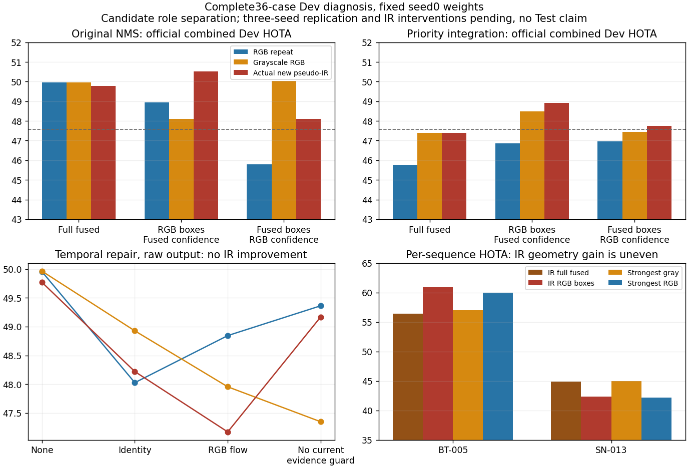

# 完整开发集：时序修正与检测头职责对照

Full4834-frame Dev, not Test. All registered rows and failures retained. Cached replay speed excludes pixel/encoder preparation and is not end-to-end FPS.

All36 fullDev cases complete after exact no-memory parity on both full videos. IR RGB-box/fused-confidence raw50.515 beats the strongest matched RGB/gray policy50.044 by0.471 in this seed0 family; same RGB-box readout RGB48.945 and gray48.111. Temporal averaging/flow do not improve the best IR parent. This is a candidate semantic/geometry separation signal, not Test improvement or established3-seed novelty. All weights/cues/policies retained.

The IR RGB-box readout improves BT-005 from56.459 to60.948 HOTA, but reduces
SN-013 from44.898 to42.354. Its combined50.515 is above the strongest matched
control50.044, while the latter gray geometry readout scores44.946 on SN.
The same RGB-box readout gives48.945 for RGB-repeat and48.111 for gray.
These seed0 results motivate replication, not a stable or Test gain claim.
Decoded RGB coordinates are copied before NMS; changing confidence can still
change selected anchors, retained boxes and downstream identities. This does
not promise that every original NMS proposal or track is preserved.

| Candidate | HOTA | DetA | AssA | IDF1 | MOTA | IDSW | Old-ID weak recoveries | New candidate births |
| --- | ---: | ---: | ---: | ---: | ---: | ---: | ---: | ---: |
| TC_gray_flow | 48.142 | 68.847 | 33.698 | 54.610 | 90.175 | 96 | 0 | 0 |
| TC_gray_flow_raw | 47.954 | 68.317 | 33.703 | 55.317 | 89.561 | 121 | 0 | 0 |
| TC_gray_identity | 48.513 | 68.742 | 34.270 | 55.853 | 90.159 | 96 | 0 | 0 |
| TC_gray_identity_raw | 48.927 | 68.374 | 35.052 | 57.198 | 89.537 | 112 | 0 | 0 |
| TC_gray_none | 47.397 | 68.633 | 32.771 | 53.653 | 90.017 | 99 | 0 | 0 |
| TC_gray_none_raw | 49.965 | 68.097 | 36.707 | 58.417 | 89.311 | 113 | 0 | 0 |
| TC_gray_rgb_boxes | 48.479 | 68.660 | 34.264 | 56.714 | 90.022 | 96 | 0 | 0 |
| TC_gray_rgb_boxes_raw | 48.111 | 68.445 | 33.856 | 55.609 | 89.966 | 103 | 0 | 0 |
| TC_gray_rgb_scores | 47.450 | 68.813 | 32.753 | 55.524 | 90.185 | 95 | 0 | 0 |
| TC_gray_rgb_scores_raw | 50.044 | 68.363 | 36.668 | 59.629 | 89.695 | 104 | 0 | 0 |
| TC_gray_without_current_evidence | 48.121 | 68.823 | 33.680 | 54.586 | 90.134 | 96 | 0 | 0 |
| TC_gray_without_current_evidence_raw | 47.347 | 68.251 | 32.885 | 54.237 | 89.339 | 130 | 0 | 0 |
| TC_ir_flow | 47.348 | 68.827 | 32.606 | 54.325 | 90.112 | 96 | 0 | 0 |
| TC_ir_flow_raw | 47.170 | 67.547 | 32.971 | 55.051 | 89.856 | 92 | 0 | 0 |
| TC_ir_identity | 47.352 | 68.831 | 32.610 | 54.339 | 90.121 | 96 | 0 | 0 |
| TC_ir_identity_raw | 48.219 | 67.868 | 34.287 | 56.122 | 89.791 | 94 | 0 | 0 |
| TC_ir_none | 47.388 | 68.873 | 32.639 | 54.337 | 90.108 | 96 | 0 | 0 |
| TC_ir_none_raw | 49.771 | 68.456 | 36.217 | 59.972 | 89.884 | 88 | 0 | 0 |
| TC_ir_rgb_boxes | 48.916 | 68.735 | 34.842 | 56.580 | 90.159 | 92 | 0 | 0 |
| TC_ir_rgb_boxes_raw | 50.515 | 68.697 | 37.170 | 59.907 | 90.235 | 86 | 0 | 0 |
| TC_ir_rgb_scores | 47.743 | 68.861 | 33.134 | 55.954 | 90.151 | 97 | 0 | 0 |
| TC_ir_rgb_scores_raw | 48.107 | 68.247 | 33.943 | 56.798 | 89.845 | 100 | 0 | 0 |
| TC_ir_without_current_evidence | 47.355 | 68.845 | 32.607 | 54.340 | 90.106 | 98 | 0 | 0 |
| TC_ir_without_current_evidence_raw | 49.168 | 68.520 | 35.311 | 58.613 | 89.802 | 96 | 0 | 0 |
| TC_rgb_flow | 45.742 | 68.849 | 30.428 | 51.965 | 90.159 | 99 | 0 | 0 |
| TC_rgb_flow_raw | 48.844 | 68.593 | 34.807 | 55.992 | 90.054 | 90 | 0 | 0 |
| TC_rgb_identity | 45.742 | 68.842 | 30.431 | 51.979 | 90.177 | 99 | 0 | 0 |
| TC_rgb_identity_raw | 48.026 | 68.559 | 33.674 | 56.139 | 90.015 | 94 | 0 | 0 |
| TC_rgb_none | 45.770 | 68.860 | 30.461 | 51.951 | 90.093 | 100 | 0 | 0 |
| TC_rgb_none_raw | 49.957 | 68.620 | 36.397 | 58.252 | 90.080 | 96 | 0 | 0 |
| TC_rgb_rgb_boxes | 46.865 | 68.855 | 31.933 | 53.995 | 90.222 | 97 | 0 | 0 |
| TC_rgb_rgb_boxes_raw | 48.945 | 68.884 | 34.812 | 57.526 | 90.237 | 93 | 0 | 0 |
| TC_rgb_rgb_scores | 46.965 | 68.792 | 32.101 | 55.067 | 90.088 | 99 | 0 | 0 |
| TC_rgb_rgb_scores_raw | 45.784 | 68.567 | 30.611 | 53.308 | 89.946 | 98 | 0 | 0 |
| TC_rgb_without_current_evidence | 47.518 | 68.847 | 32.831 | 54.299 | 90.166 | 97 | 0 | 0 |
| TC_rgb_without_current_evidence_raw | 49.362 | 68.401 | 35.651 | 57.118 | 89.966 | 95 | 0 | 0 |

No current Dev family establishes the original >=+5 Test HOTA and2-3 independent contribution objective. Full metric fields, per-sequence values, configuration hashes and exact runtime source versions are in the adjacent JSON.

Classical threshold changes, generic memory and ordinary supervised heads receive no multimodal novelty credit alone. Historical Test was exposed before this campaign; original RGB pretraining also included present Dev videos.
