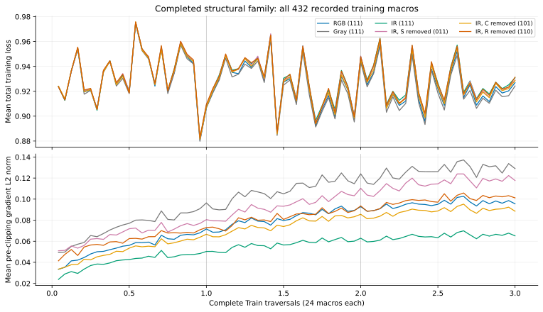
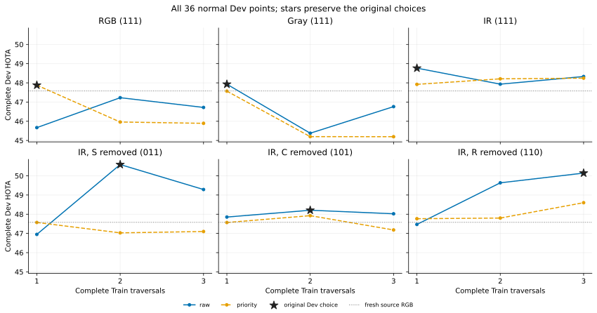
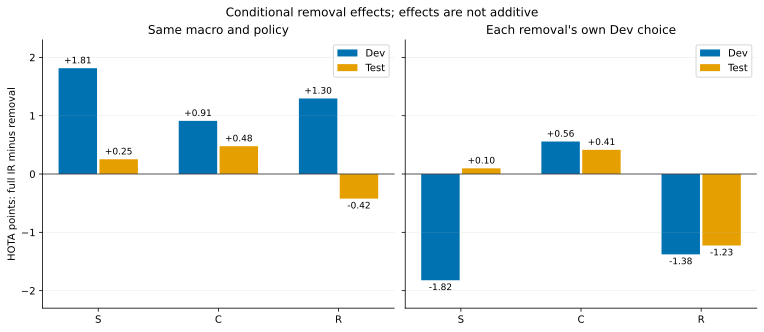
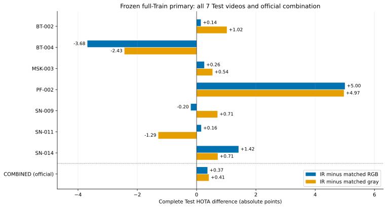

# 六组全量训练的曲线与贡献图：原始值、选择及限制

四张SVG图只整理已经完成的六组固定几何S/C/R实验，不新增训练、随机种子、Dev/Test推理或选择。全部432条原始训练宏循环、36个正常Dev点和全部七段Test均保留；所绘HOTA逐项读取并核对Git中63份原详细CSV的逐字节副本，SHA与原独立审计相同。该图集不是正在训练的原生CNN／时序方案的结果。



上图横轴按原固定日程换算：24宏循环才是一遍完整27251帧Train，72宏循环共三遍、20736次更新；稳定B4日程另含1191次padding访问。每点为原288次更新的均值，不平滑、不删点。上半是总loss，下半是裁剪前梯度L2范数，原第五列不是loss。逐宏loss明显随所取帧组波动，但六组按整遍平均的总loss均小幅下降；完整IR从0.933048降至0.927240，减少约0.005808。该下降没有对应持续的Dev改善，不能把运行、非零梯度或loss下降当作泛化提升。它是固定几何的语义目标，不与新原生网络完整YOLOX目标的loss绝对值比较。

| 原完整拟合 | 第一遍24宏均值loss | 第二遍24宏均值loss | 第三遍24宏均值loss |
| --- | ---: | ---: | ---: |
| rgb_111_s0 | 0.93239443 | 0.92612435 | 0.92274400 |
| gray_111_s0 | 0.93164421 | 0.92430499 | 0.92024605 |
| ir_111_s0 | 0.93304828 | 0.92899387 | 0.92723978 |
| ir_011_s0 | 0.93310747 | 0.92838092 | 0.92574273 |
| ir_101_s0 | 0.93265875 | 0.92729673 | 0.92486489 |
| ir_110_s0 | 0.93353820 | 0.92875180 | 0.92670720 |



六组各三快照×raw／priority两策略，共36个正常Dev点；星号直接读取原来已经冻结的选择，不在绘图时重新求最优。另14项输入干预／源RGB对象未混入这六条正常曲线，但其原CSV也核对并保持不变。虚线参照是源fresh RGB完整Dev。原RGB自身最佳采用priority，灰度和完整IR自身最佳采用raw，均保留原Dev选择；配对消融则固定完整IR同轮次／同策略。完整IR、RGB和灰度的所选快照都在第一遍，去S、去C、去R分别在第二、第二、第三遍，不能一概断言“训练越久越好”或“所有方法都已饱和”。

| 拟合 | 原选择ID | 完整Train遍数 | 策略 | 完整Dev HOTA |
| --- | --- | ---: | --- | ---: |
| rgb_111_s0 | FT_rgb_111_s0_e24_priority | 1 | priority | 47.878421 |
| gray_111_s0 | FT_gray_111_s0_e24_raw | 1 | raw | 47.928942 |
| ir_111_s0 | FT_ir_111_s0_e24_raw | 1 | raw | 48.764689 |
| ir_011_s0 | FT_ir_011_s0_e48_raw | 2 | raw | 50.586362 |
| ir_101_s0 | FT_ir_101_s0_e48_raw | 2 | raw | 48.207604 |
| ir_110_s0 | FT_ir_110_s0_e72_raw | 3 | raw | 50.142461 |

这些曲线描述已有固定几何家族，只有三处完整Dev快照，不能证明性能变化的唯一原因。新质量／时序原生方案允许训练框、objectness和类别联合目标，仍按原登记的至少六遍完整Train及完整Dev规则执行，不能用本图提前判定其成败或缩短预算。



每个柱子都是“完整IR−去除该组件”，正值支持本次条件效应。左图固定同轮次和策略；右图使用每个去除模型自己的原Dev最佳。C在这两种Dev/Test口径都为正；S在自身最佳Dev口径为负、Test小幅正，R在自身最佳Dev及两种Test口径均负。差值来自同一家族的去除对照，不能相加为总提升。当前仍缺RGB／灰度各自C关闭训练和完整模态×C交互，原理也有相关先例，不能据图认定2–3项独立创新。固定seed0，没有构造重复种子误差条或显著性结论。



全部七段与官方COMBINED保留，COMBINED由原CSV直接读取，不是七段HOTA的算术均值。主IR对同预算RGB为五段正、两段负：PF-002约+5.002点，BT-004约−3.684点；整体仅+0.366995。单段超过5点不能替代整体目标。对同预算灰度整体+0.412215，对原始RGB29.529为+0.305177，主方法仍29.834177，目标仍34.529。没有使用这些Test图修改已登记方案或重选模型。

实际CPU导出R3退出0，完整调用4.133秒、观测峰值RSS0.100GiB；进程启动时刻和argv实测一致。四图均已视觉检查。R1图例遮挡了一个点，R2移出图例；R3改为读取Git内公开CSV，四份SVG与已通过视觉检查的R2逐字节相同。前两次渲染与代码原件保存在工作盘，没有额外神经试验或改动科学数值。Git只保存SVG、文本和代码，PNG仅用于本地版式检查。

复现命令（使用新的输出目录；本次Matplotlib版本3.10.9）：

```bash
cd /data3/liuyeqiang/IR-MFT
CUDA_VISIBLE_DEVICES='' MPLCONFIGDIR=/var/tmp/ir_mft_plot_config \
  /data3/liuyeqiang/.venvs/trackocd-a100/bin/python tools/plot_mft_full_train_evidence.py \
  --output-directory /var/tmp/ir_mft_figures_reproduced \
  --preview-directory /var/tmp/ir_mft_figures_preview_reproduced
```

图源及全部绘图原数值见[完整JSON](PERCEPTUAL_MFT_20261125_FULL_TRAIN_FIGURES.json)，实际执行见[执行记录](PERCEPTUAL_MFT_20261125_FULL_TRAIN_FIGURES_EXECUTION.json)，原登记及真实训练进程的核对见[来源记录](PERCEPTUAL_MFT_20261125_FULL_TRAIN_FIGURES_SOURCE_AUDIT.json)。历史Test暴露、原RGB预训练见Dev及RGB派生IR限制保持。独立创新计数0，Goal保持active。
