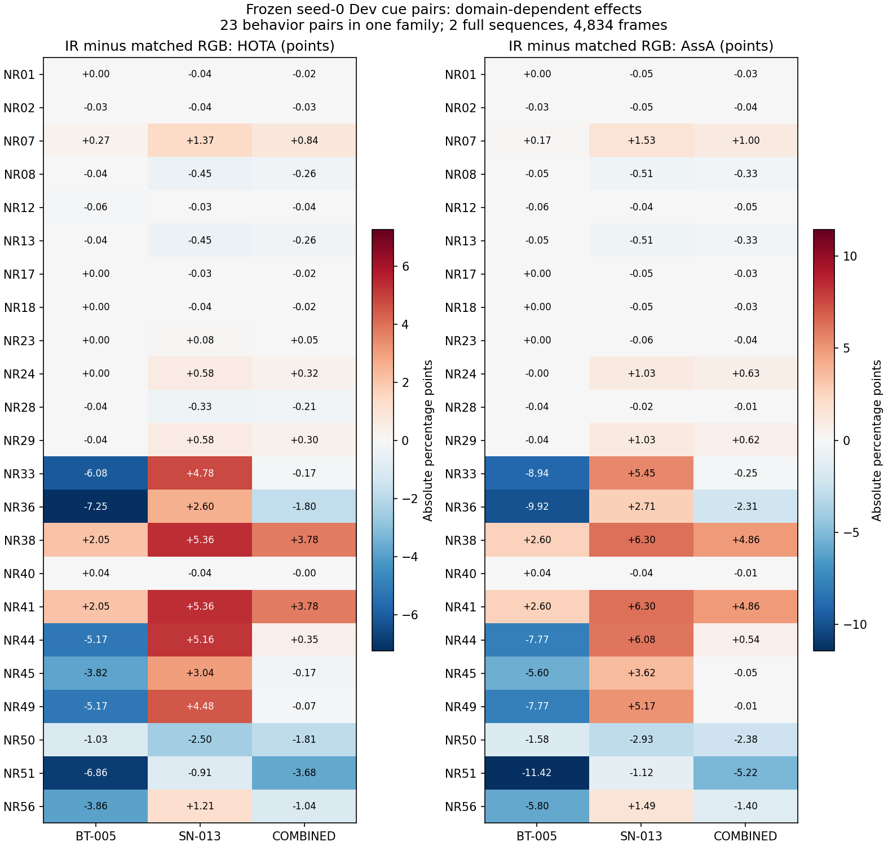

# 新版IR身份分支：完整Dev的逐序列诊断

原先58组行为配置中的23组RGB/IR配对，汇总Dev HOTA较高的有7组；两个Dev序列都较高的只有4组，有9组收益方向随序列反转。

进一步要求两个序列都胜过匹配RGB及自身增量关闭对照，满足的为0组。这是完整Dev上的必要数值检查，不能当成创新性证明或总体因果结论。

本次只读取原先冻结的Dev快照、完整4834帧指标和276列官方CSV，没有重新推理、拟合、搜索阈值或读取Test准确率。原始双Dev选择不改，12个未配对的IR干预行为仍保留。23对不是23种架构，也不是独立重复实验。

颜色与文字均为IR−RGB绝对百分点；图中保留两位小数，不表示统计显著性。完整精度、确切快照、逐项配置、来源与关闭对照见相邻JSON。

| IR配置 | BT-005 ΔHOTA | SN-013 ΔHOTA | COMBINED ΔHOTA | 两段均正 |
| --- | ---: | ---: | ---: | --- |
| NR01_consensus_query_rgb_ir | +0.000000 | -0.040953 | -0.021230 | 否 |
| NR02_consensus_query_rgb_ir | -0.028009 | -0.040953 | -0.033670 | 否 |
| NR07_ordered_query_rgb_ir | +0.266385 | +1.374368 | +0.842075 | 是 |
| NR08_ordered_query_rgb_ir | -0.039912 | -0.449647 | -0.255108 | 否 |
| NR12_reachable_query_rgb_ir | -0.057935 | -0.031589 | -0.043937 | 否 |
| NR13_reachable_query_rgb_ir | -0.039912 | -0.449647 | -0.255108 | 否 |
| NR17_consensus_query_new_ir | +0.002695 | -0.034518 | -0.018990 | 否 |
| NR18_consensus_query_new_ir | +0.000000 | -0.036195 | -0.020722 | 否 |
| NR23_ordered_query_new_ir | +0.000000 | +0.078633 | +0.049232 | 否 |
| NR24_ordered_query_new_ir | +0.003404 | +0.580529 | +0.320813 | 是 |
| NR28_reachable_query_new_ir | -0.037623 | -0.330295 | -0.213854 | 否 |
| NR29_reachable_query_new_ir | -0.037624 | +0.580529 | +0.303563 | 否 |
| NR33_counterfactual_query_rgb_ir | -6.079353 | +4.779117 | -0.168930 | 否 |
| NR36_native_query_rgb_ir | -7.245584 | +2.598175 | -1.799879 | 否 |
| NR38_counterfactual_query_new_ir | +2.045547 | +5.355375 | +3.777965 | 是 |
| NR40_counterfactual_query_new_ir | +0.037623 | -0.036543 | -0.003684 | 否 |
| NR41_counterfactual_query_new_ir | +2.045547 | +5.355375 | +3.777965 | 是 |
| NR44_counterfactual_query_new_ir | -5.169934 | +5.164464 | +0.347385 | 否 |
| NR45_counterfactual_query_new_ir | -3.824032 | +3.038732 | -0.173526 | 否 |
| NR49_counterfactual_query_new_ir | -5.169934 | +4.482583 | -0.071943 | 否 |
| NR50_counterfactual_query_new_ir | -1.031466 | -2.504304 | -1.813311 | 否 |
| NR51_counterfactual_query_new_ir | -6.863166 | -0.914039 | -3.682220 | 否 |
| NR56_native_query_new_ir | -3.858641 | +1.206848 | -1.039249 | 否 |

## NR36的反转来自哪些指标

该分支两个序列的DetA变化都远小于AssA变化：

| Dev序列 | ΔHOTA | ΔDetA | ΔAssA | ΔIDF1 | ΔIDSW | ΔFrag |
| --- | ---: | ---: | ---: | ---: | ---: | ---: |
| BT-005 | -7.245584 | -0.168240 | -9.916235 | -9.313990 | +4 | +9 |
| SN-013 | +2.598175 | +0.572785 | +2.706934 | +4.424492 | -3 | -4 |
| COMBINED | -1.799879 | +0.283113 | -2.312779 | -0.999969 | +1 | +5 |

BT-005的匹配RGB HOTA51.180303，而IR43.934719；SN-013则为RGB36.598172、IR39.196347。汇总DetA略增而AssA下降，不能靠汇总IDSW接近就认定身份保持接近。

脚本还逐个IoU阈值核验 `log(HOTA_IR/HOTA_RGB) = 0.5 log(DetA_IR/DetA_RGB) + 0.5 log(AssA_IR/AssA_RGB)`。COMBINED的19个阈值中，关联项绝对值都更大。这里只是官方指标的代数分解；没有用DetA与AssA的AUC均值重建HOTA，也不把平均对数项称为百分点或因果贡献。

## 对下一步研究的约束

这支持继续区分检测变化和身份变化，并要求分序列、普通RGB记忆、相同质量权重、自身关闭和真实错位／缺失控制；不能据序列标签设计Test路由，也不能据此证明某一种质量门控已经有效。

NR24在两个序列都略胜匹配RGB，但相对自身关闭并非两段都正；NR07汇总仍低于自身关闭。NR38和NR41的IR汇总均47.348568，对较弱RGB43.570603为正，仍低于原始RGB Dev约47.579，且缺少严格关闭对照。不能从这四项选择新主模型。

关闭对照本次可从12项原始完整Dev读取，比先前只在回放补测目录核对的8项多；这是找回原始已有证据，没有新增推理。未知关闭结果仍保留未知。

并行的72帧Train诊断预登记见[mechanism specification](../../configs/perceptual_mechanism_diagnosis_20261125.json)。它检查全Train拟合后的实际视觉修正，不是上述描述向量分支的新融合架构，也不替代尚待完成的完整Dev/Test。

历史Test已暴露、原RGB预训练见过当前Dev、辅助表示源于RGB的限制继续保留。当前独立多模态贡献0、+5目标未达，Goal保持active。

复现：先在CPU环境运行 `tools/diagnose_native_dev_domains.py`，再运行 `tools/report_native_dev_domains.py`。输入与输出已存在时脚本拒绝覆盖。
