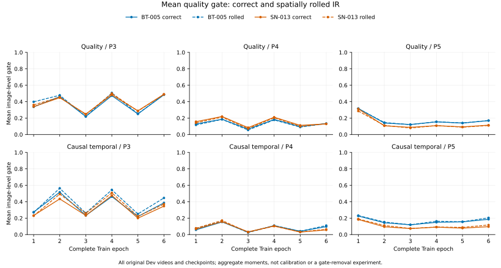
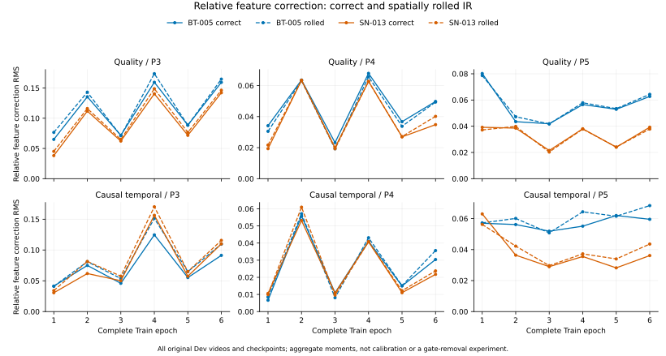

# 完整 Dev 门控诊断：动态门控尚未稳定拒绝错配

本次只读取原生家族前六轮已完成的真实生产记录：六组正常模型及 IR 缺失/图像错位，共 60 个带门控条件；两个完整 Dev 视频共 4,834 帧，每个条件的三个层级全部保留，共 360 条层级记录。另保留原官方报告中的两个 RGB 源条件。没有新训练、前向、TrackEval、Test 读取或选模。

## 全部配对结果

| 统计单位 | 数量 | 错位后门控均值更高 | 错位后修正相对 RMS 更高 |
| --- | ---: | ---: | ---: |
| quality × 六轮 × 两视频 × 三层 | 36 | 15 | 19 |
| temporal × 六轮 × 两视频 × 三层 | 36 | 31 | 29 |
| 全部层级配对 | 72 | 46 | 48 |

72 个配对共享轮次、视频或层级，不是 72 次独立试验。相反方向的 26 个门控配对和全部负结果均保留；没有只展示第六轮。24 个模式/轮次/视频级 HOTA 配对中，正确 IR 高于错位 IR 的有 14 个、低于的有 10 个。HOTA 不是把三个层级分别算三次，更不能把逐视频 HOTA 平均当官方总 HOTA。

门控确实随输入、视频和轮次变化，不能说它恒定或未学习。但在目前表现较好的 temporal IR 第六轮，两个视频的 P3/P4/P5 平均门控在错位后全部升高，修正相对 RMS 也全部升高：

| 视频 | 层级 | 正确 IR 门控 | 错位 IR 门控 | 正确 IR 修正 RMS 比值 | 错位 IR 修正 RMS 比值 |
| --- | --- | ---: | ---: | ---: | ---: |
| BT-005 | P3 | 0.386023 | 0.445791 | 0.091273 | 0.109579 |
| BT-005 | P4 | 0.096652 | 0.109737 | 0.030389 | 0.035618 |
| BT-005 | P5 | 0.185722 | 0.203677 | 0.059535 | 0.068380 |
| SN-013 | P3 | 0.346078 | 0.370094 | 0.109995 | 0.115634 |
| SN-013 | P4 | 0.056525 | 0.063870 | 0.021739 | 0.023740 |
| SN-013 | P5 | 0.095736 | 0.116359 | 0.036138 | 0.043581 |

这里的图像错位来自原登记的实际 IR 空间 roll，同一配对的检查点摘要相同。该现象提示当前全局门控没有稳定的错配抑制响应；它不等于正式校准误差，也不能证明 HOTA 差异由门控单独造成。错位同时改变了辅助特征和时序更新，仍需原计划的同预算去除/组合实验来归因。





## RGB 特征保护实际覆盖的范围

288 条有模态输入的层级记录中，同一视频/层级的 teacher 保护格点数量在所有正常与错位条件下完全一致，且被保护格点的特征变化数均为 0。72 条缺失输入层级记录没有伪造门控均值、方差或修正量，仍为空值。

| 视频 | 层级 | 有效格点观测数 | 受保护格点观测数 | 覆盖比例 |
| --- | --- | ---: | ---: | ---: |
| BT-005 | P3 | 32645200 | 6 | 0.00001838% |
| BT-005 | P4 | 8161300 | 107974 | 1.32300001% |
| BT-005 | P5 | 2017400 | 45 | 0.00223059% |
| SN-013 | P3 | 53400000 | 4 | 0.00000749% |
| SN-013 | P4 | 13350000 | 59659 | 0.44688390% |
| SN-013 | P5 | 3300000 | 126808 | 3.84266667% |

保护条件是原 RGB teacher 置信度达到 0.6；它不是 GT 前景掩码。P3 在两个视频共约 8,604 万个格点观测中只有 10 个达到该条件，因此不能把这项保护描述成覆盖大多数特征的安全保证。其余格点的非零差值仅表示转换回原 dtype 后至少一个通道变化，不代表检测框、身份或全部像素发生了同等幅度的变化。原检测头的邻域运算仍可能改变受保护格点附近的输出。

## 对后续研究的实际影响

目前不能把“全局质量门控”直接计作已验证的可靠性创新。已有 source review 表明门控使用每图/每层汇总描述；这次真实完整 Dev 补上了它对实际错位的响应证据。后续需要检查局部对应关系与任务收益是否受到监督，以及其增量能否超出同预算 RGB/灰度控制。

现有 spatial 与 TaskUtility 候选已经登记局部/前景/任务效用相关对照，继续按其原完整工程、训练、Dev、Test 流程验证；本诊断没有修改它们的假设、预算、选模范围或源码。原 native 共同九轮训练和条件触发的消融也继续，不提前挑选 Test 模型。门控的跨轮次变化尚不能归因于训练顺序或某个优化细节，这需要另外的匹配反事实证据。

## 核查与复现范围

实际审计工具退出 0，内部墙钟 0.564622 秒，进程报告峰值 RSS 0.459766 GiB；绘图实际会话 67991 退出 0，两张 PNG 预览已目视检查，仅发布 SVG。原完整 Dev 报告、62 份官方 CSV、62 份原指标 JSON、两个生产元数据及相关代码共 131 个源文件摘要在分析前后保持一致。新分析复用已核验的官方 Dev 数值，只新增元数据解析和描述性比较，没有再次运行指标计算。

首次 CLI 的输入检查误以为原报告用列表存放序列；原文件实际保存精确的序列/帧数映射。该次在输出目录创建前退出 1，未运行模型；旧源码和失败回执留在工作目录，回执随报告公开。修正兼容原映射后，实际完整分析退出 0。

新小型分析脚本位于冻结训练源码集合之外。原 native 的 102 项和最终 TaskUtility 的 427 项文件重新核对未变，原两卡进程和七个 CPU 等待队列均直接验证。工作目录约 59.809861 GiB / 64 GiB，独立可用空间约 2664.640072 GiB；未复制权重、图像、特征银行或轨迹。

生产元数据只保存每段均值/标准差/范围，无法据此恢复逐帧门控、定位某条身份错误、计算 AUROC 或证明局部校准。内部协方差也不是物理传感器噪声。伪 IR 仍由 RGB 派生，历史 Test 暴露与 RGB 预训练见过当前 Dev 的限制保持。此诊断不新增准确率或独立贡献计数，Goal 仍未完成。

```bash
CUDA_VISIBLE_DEVICES='' PYTHONDONTWRITEBYTECODE=1 /usr/bin/python3 -u tools/audit_mft_native_dev_gate_statistics.py --output-directory /var/tmp/a_new_exclusive_native_gate_audit
```

[机器可读报告](PERCEPTUAL_MFT_20261126_NATIVE_DEV_GATE_DIAGNOSIS.json) · [全部 360 条记录](perceptual_20261126_native_dev_gate_diagnosis/all_complete_Dev_gate_levels.csv) · [全部 72 项配对](perceptual_20261126_native_dev_gate_diagnosis/all_paired_normal_vs_roll.csv) · [实际执行证明](perceptual_20261126_native_dev_gate_diagnosis/actual_CPU_and_figure_execution.json) · [源字段与文件清单](perceptual_20261126_native_dev_gate_diagnosis/publication_manifest.json) · [前六轮完整官方指标](PERCEPTUAL_MFT_20261126_NATIVE_MINIMUM6_FULL_DEV.json) · [已有逐身份诊断](PERCEPTUAL_MFT_20261126_NATIVE_DEV_TRACK_ERRORS.md)
