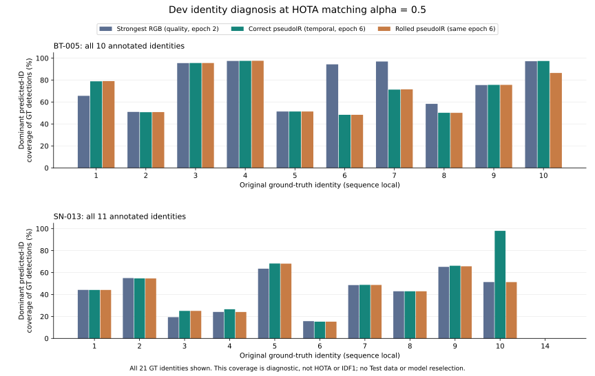

# 完整 Dev 逐目标诊断：身份关联收益集中，跨目标稳健性仍不足

这项分析解释已公开的最低六轮 Dev 结果，不产生新 Test 结论，不改变检查点选择。时序 IR 的完整 Dev HOTA 为 50.115210，相对直接 RGB 为 +2.536048，但相对跨结构最强 RGB 仅 +0.196732。质量模式 IR 相对对应 RGB 仍为 −0.215090。当前不能据此宣称已形成 2–3 项独立创新。

诊断覆盖六组各自按原 Dev 规则选出的检查点、六组统一第 6 轮检查点、两种 RGB 源，以及时序 IR 第 6 轮的实际图像错位和缺失条件，去重后共 14 个条件。每个条件都使用 BT-005、SN-013 两段完整 Dev，共 4834 帧，没有排除困难目标或帧。保留全部 21 个官方有效 GT 身份，得到 294 条记录；灰度及其他负面条件均在完整表中。

调用原定制 TrackEval 数据类及未改动的 HOTA 实现，通过 CPU profile 钩子只观察该实现返回时的真实匹配矩阵，不另写一套目标匹配算法。输入 MOT、GT、逐序列长度和上游官方 CSV 均有 SHA-256 约束；核验原注册科学代码保持不变。每个条件的逐视频和 COMBINED 结果均逐项对照原 CSV 的 19 个阈值、12 个数组字段和 3 个标量字段，共 9702 次数值核验；均通过。全部数组也保存在原始诊断 JSON 中。

逐目标诊断固定使用 HOTA 匹配阈值 α=0.5。定义“主预测 ID 覆盖率”为 `max_p matched(g,p) / GT_detections(g)`：对某个真实目标，找与它匹配次数最多的一条预测身份，再除以该目标的全部有效标注次数。这是描述性诊断，**不是逐目标 HOTA、IDF1、CLEAR IDSW 或 Frag**；也没有定位错误发生的具体时间。

| 视频／原 GT ID | 最强 RGB 主 ID 覆盖率 | 时序 IR 主 ID 覆盖率 | 最强 RGB 匹配次数 | 时序 IR 匹配次数 |
| --- | ---: | ---: | ---: | ---: |
| BT-005／6 | 94.33% | 48.36% | 1730 | 1721 |
| BT-005／7 | 96.95% | 71.32% | 1778 | 1787 |
| SN-013／10 | 51.33% | 98.03% | 2940 | 2941 |

BT-005 的目标 6、7 是相对最强 RGB 的显著负面例子。目标 6 只少匹配 9 次，但主 ID 所覆盖的匹配由 1730 次降至 887 次，匹配到的预测身份从 1 个变成 2 个。目标 7 的总匹配反而多 9 次，主 ID 覆盖率仍明显下降。因此，这两个目标的差异不能简单归结为漏检数量；其预测身份分配也发生明显变化。相同匹配身份个数并不保证其分配质量相同，这也说明只看 ID 数量不足。

SN-013 的目标 10 则是明显的正面例子：匹配总数相对最强 RGB 仅多 1 次，但主预测 ID 的匹配从 1539 次增至 2939 次。在该视频中，它占“各目标主 ID 匹配次数正向变化之和”的 77.78%。这个比例只描述该诊断计数的集中程度，不能解释为贡献了 77.78% 的 HOTA 提升。

同权重、同第 6 轮的实际图像错位对照也体现这一现象。SN-013／10 在正确 IR 和错位 IR 下都匹配 2941 次，但主 ID 匹配分别为 2939 和 1538 次，覆盖率为 98.03% 和 51.30%。正确输入相对错位输入的完整 Dev HOTA 为 +2.241000；不过这条轨迹占 SN-013 主 ID 匹配正向变化总量的 93.78%。这支持继续检验实际输入内容的组合收益，同时暴露收益集中，不能证明独立热信息、记忆模块的单独作用或新颖性。

| 时序 IR 相对对照 | 视频 | 主 ID 覆盖率改善／退化／相同的 GT 数 |
| --- | --- | ---: |
| 跨结构最强 RGB | BT-005 | 5／4／1 |
| 跨结构最强 RGB | SN-013 | 7／3／1 |
| 同时序结构各自 Dev 最佳 RGB | BT-005 | 3／6／1 |
| 同时序结构各自 Dev 最佳 RGB | SN-013 | 2／8／1 |

相对同时序结构 RGB，完整 Dev HOTA 虽为 +2.018149，但上述覆盖率在 21 个目标中只有 5 个改善、14 个退化、2 个相同。目标并非独立统计重复，这也不是所有官方指标的方向；它说明不能把平均 HOTA 正向直接解释成多数目标身份保持都变好。全部 16 项描述性比较和 336 条成对目标记录均保留，未只展示表中的例子。

后续仍执行原预登记的六组统一 9 轮及可能的共同 12 轮预算、完整 Dev 决策、触发的几何／记忆／保护等去除实验，以及全部正常条件和正式干预的完整 7 段 Test。该诊断提示后续需要检查身份分配的收益和损失，当前没有依据在几何变化、时序记忆、融合门控或跟踪阈值之间单独归因，也不按视频标签或 GT 身份设置路由。

CPU 诊断只读取现有轨迹和标注，没有图像、模型、权重加载或优化，没有新增种子或占用训练 GPU。最终严格核验实际用时 122.74 秒，峰值 RSS 0.12138 GiB；这是这个 CPU 诊断的成本，不是方法端到端速度。首次调用曾因定制 TrackEval 接口只接受序列参数而在任何序列评估前退出 1，修正后的实际执行退出 0；加强逐阈值 CSV 检查后的执行也退出 0，相关收据、日志与旧代码快照保留。最终执行成本见实际收据。

伪 IR 来源于 RGB、历史 Test 已暴露、RGB 预训练见过 Dev、单 seed0、只有两段 Dev 等限制继续成立。此处不作统计显著性、因果创新或泛化成功宣称。独立创新计数仍为 0，测试集 +5 点目标尚未完成。

[完整成对分析](PERCEPTUAL_MFT_20261126_NATIVE_DEV_TRACK_ERRORS.json) · [全部逐目标记录](perceptual_20261126_native_dev_track_errors/all_Dev_GT_identity_diagnostics.csv) · [原始匹配与逐阈值核验](perceptual_20261126_native_dev_track_errors/complete.json) · [上游全部 62 条件的 47 官方字段](PERCEPTUAL_MFT_20261126_NATIVE_MINIMUM6_FULL_DEV.json)
