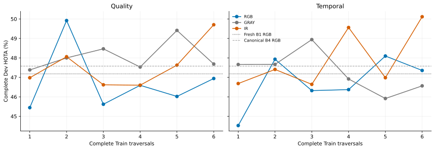
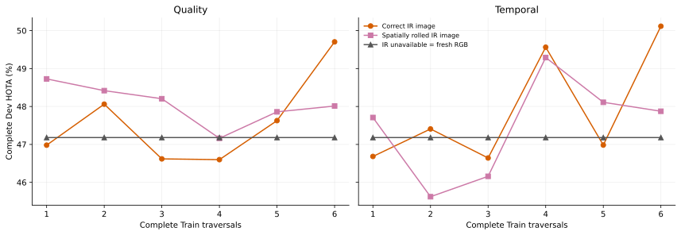
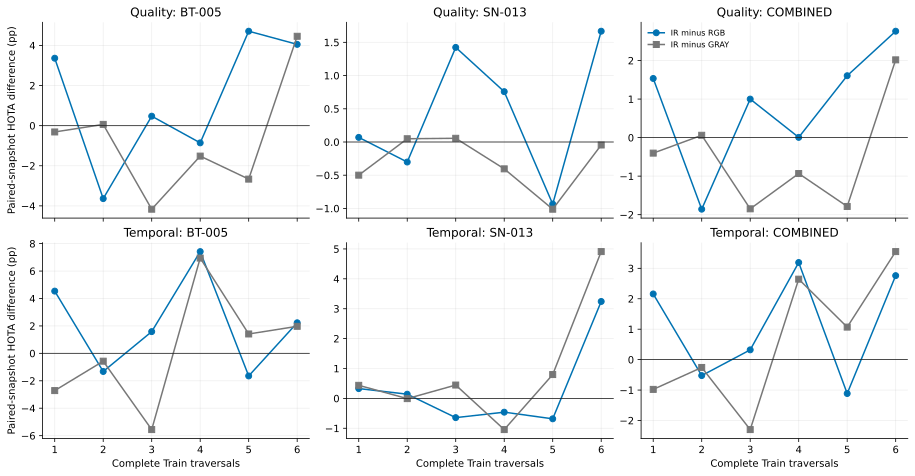

# 前六轮完整Dev：有组合收益候选，独立创新仍待验证

以下数值全部来自两个完整Dev视频、4834帧。全部62项条件及原65个生产／规范源／官方评估worker均完成并实际退出0，独立47字段审计也实际退出0。这是最低六轮阶段结果，不是完整Test、最终模型选择或收敛结论。

时序IR（NP_temporal_ir_e06）HOTA为50.115210，对同模式各自Dev最佳RGB为+2.018149点，对灰度为+1.173744。对规范直接RGB为+2.536048，对新鲜B1 RGB为+2.934166。

跨两种结构的最强RGB是NP_quality_rgb_e02，HOTA为49.918478；时序IR只高+0.196732点。因此不能只展示较大的同模式差值来宣称突破。该跨结构比较是额外强对照，不替代原预登记的同模式比较或改变选择。

| 完整Dev条件 | 检查点 | HOTA | DetA | AssA | IDF1 | MOTA | IDSW |
| --- | --- | ---: | ---: | ---: | ---: | ---: | ---: |
| 规范直接RGB | NP_source_canonical_RGB | 47.579 | 68.864 | 32.908 | 55.865 | 90.200 | 94 |
| 新鲜B1 RGB | NP_source_fresh_RGB | 47.181 | 68.818 | 32.384 | 55.342 | 90.127 | 96 |
| quality_rgb | NP_quality_rgb_e02 | 49.918 | 67.931 | 36.715 | 58.576 | 89.884 | 93 |
| quality_gray | NP_quality_gray_e05 | 49.414 | 69.074 | 35.378 | 57.678 | 90.198 | 92 |
| quality_ir | NP_quality_ir_e06 | 49.703 | 68.231 | 36.238 | 57.982 | 90.125 | 88 |
| temporal_rgb | NP_temporal_rgb_e05 | 48.097 | 69.004 | 33.558 | 56.545 | 90.166 | 94 |
| temporal_gray | NP_temporal_gray_e03 | 48.941 | 68.910 | 34.791 | 57.044 | 90.261 | 89 |
| temporal_ir | NP_temporal_ir_e06 | 50.115 | 68.248 | 36.840 | 59.668 | 90.011 | 96 |

质量模式IR相对本模式RGB为-0.215090点，未超过对应RGB强对照。负结果与全部正常曲线继续保留，不能只把时序IR列出来。

| 时序IR−对照，完整视频 | 同模式RGB | 同模式灰度 | 跨结构最强RGB | 同检查点图像roll |
| --- | ---: | ---: | ---: | ---: |
| BT-005 | +1.579778 | -1.335841 | -4.039149 | +0.754073 |
| SN-013 | +2.416668 | +3.351463 | +3.861608 | +3.515463 |
| COMBINED | +2.018149 | +1.173744 | +0.196732 | +2.241000 |

时序IR相对同模式RGB在两段都为正，相对灰度在BT-005为负；相对跨结构最强RGB则两段方向反转。不能把汇总正差值解释成每个场景都稳定获益，也不能用序列标签设计Test路由。

时序IR对同模式RGB的AssA差为+3.282186、IDF1为+3.123729，而DetA为-0.755566、MOTA为-0.154969，IDSW多2次。当前正向主要体现在关联指标，并非所有指标均提升；这不是对HOTA的精确因果分解或对记忆模块的独立归因。

时序IR的正确图像相对同权重真实图像roll为+2.241000点，两段视频各自也为正。全部12个缺失条件的47字段、逐序列、完整CSV及MOT均精确回到新鲜B1 RGB。这些结果支持继续验证当前IR输入的组合收益，不代表额外物理热信息或新颖性证明。

| 同轮时序结构−质量结构，HOTA差 | RGB | 灰度 | IR | IR−RGB增量差 |
| --- | ---: | ---: | ---: | ---: | ---: |
| 1 | -0.920448 | +0.278909 | -0.297130 | +0.623318 |
| 2 | -1.986028 | -0.335003 | -0.653430 | +1.332599 |
| 3 | +0.702122 | +0.474783 | +0.023543 | -0.678578 |
| 4 | -0.220966 | -0.612606 | +2.963510 | +3.184476 |
| 5 | +2.076222 | -3.499350 | -0.643989 | -2.720211 |
| 6 | +0.412979 | -1.120762 | +0.411822 | -0.001157 |

第6轮中，时序结构给IR和RGB带来的增量分别约+0.412和+0.413点，二者差约−0.001。当前不能把时序结构收益说成IR独有。结构之间还同时改变记忆、运动对齐与内部置信递归；上表只是描述性交互，不能替代独立模块去除或统计因果估计。跨轮交互方向也不稳定。

原冻结预算决定已授权六组统一从6延长到9轮：质量灰度后期峰值比前三轮高0.947，质量IR高1.642，时序IR高2.707，均超过原0.2点阈值。训练沿用单一12轮学习率时间轴，不重置学习率，不增加随机种子；RGB、灰度和IR全部共同延长。训练曲线与指标均非单调，当前不宣称收敛。后续是否到12轮仍按同一完整Dev规则决定。

独立创新计数仍0。当前只有需要继续验证的多模态组合候选；最终仍须完整预算选择、触发的同预算去除／组合实验、全部正常条件含负条件的7段15985帧Test、逐方法成本与先验工作边界核对。Test目标34.529及2–3项独立贡献尚未实现。历史Test暴露、RGB预训练见Dev、伪IR由RGB生成、单seed0等限制保持。

[全部62项47字段](PERCEPTUAL_MFT_20261126_NATIVE_MINIMUM6_FULL_DEV.json) · [原始47字段总表](PERCEPTUAL_MFT_20261126_NATIVE_MINIMUM6_FULL_DEV.csv) · [完整描述性比较](PERCEPTUAL_MFT_20261126_NATIVE_MINIMUM6_FULL_DEV_ANALYSIS_ZH.json)
