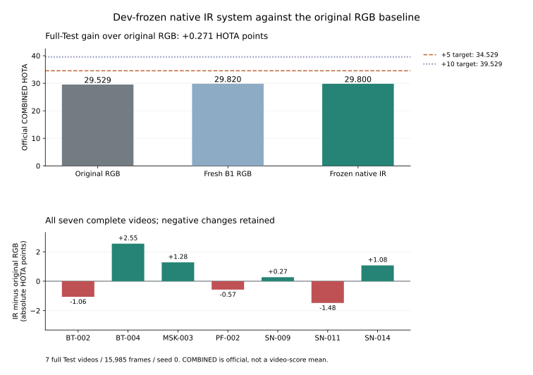

# 完整Test分析：仅+0.271 HOTA，目标尚未达到

预先按Dev选择的NP_temporal_ir_e06在完整七段15985帧Test上HOTA **29.799525**，原始无红外YOLOX-X＋ByteTrack为**29.528971**，绝对提升**+0.270555点**。没有达到+5或+10目标。该结果不是按Test选出的最优，不能把Dev的+2.536点当成Test提升。

| 条件 | HOTA | DetA | AssA | IDF1 | MOTA | IDSW |
| --- | ---: | ---: | ---: | ---: | ---: | ---: |
| 原始RGB，规范B4 | 29.528971 | 46.186593 | 18.967548 | 33.072407 | 50.898476 | 450 |
| 新鲜RGB，B1 | 29.820430 | 46.198493 | 19.339960 | 33.094038 | 50.871563 | 449 |
| 本轮冻结IR主方案 | 29.799525 | 46.542873 | 19.163110 | 32.662720 | 51.108259 | 487 |

新鲜B1使用相同基础RGB权重及ByteTrack，没有训练新的RGB结构。IR主方案相对它的HOTA为-0.020905点；因此不能把对原始B4的全部+0.271归为IR独立收益。原始基线继续固定为原始规范B4，不以新鲜B1替换用户要求的比较对象。

相对原始RGB，DetA为+0.356279、AssA为+0.195562、MOTA为+0.209782；IDF1为-0.409687，IDSW增加37次。检测改善不足以证明身份保持改善。七段HOTA中4段提高、3段降低；全部逐视频及47字段、原CSV和负值均保留。此处只描述结果，不能单凭这些汇总把退化独立归因给几何、门控或记忆。

主模型的原Dev选择与检查点都未改变，冻结文件早于本轮Test启动。原7个神经生产、1个规范来源生产、3个官方评估worker共11个均实际退出0。独立CPU审计验证1128个原官方字段值和21份实际MOT轨迹；它读取同一官方CSV，不重新运行评估或神经网络。

原汇总控制器因抄录常数29.5289636096556与原CSV的29.528970687393972相差0.000007078点而断言退出1。原始与本次规范RGB CSV哈希均为`c63ae33bbb01f14009da3dd3f834b017907df02958fe5200c68f20f38dc6fc6a`，基线方法、数据和CSV完全未改。只读CPU修复及随后独立审计均实际退出0，所有失败状态、日志和旧源码保留；没有重跑推理、改选检查点、改阈值或新种子。

后续同一伪红外模型的外观记忆方案仍为此前Test出数前预登记的0／0.05／0.1三个权重，科学配置、模型与正常case元数据逐项相同。V2因真实前序汇总错误正确停止且未使用GPU；V3只加入对独立CPU修复的明确验证，9个加载／神经工程／生产／评估／布局函数AST与V2相同。当前4/5卡各12帧真实Train工程已通过，正在执行完整Dev，只有Dev的正常选择可授权下一轮Test，没有根据本轮Test点数改三个权重。

较早V1的COMBINED行布局问题已在任何GPU工作前修复，真实原Dev CSV141字段回归通过；原四个不同Train帧的CPU图像检查按字节复用。版本号是执行与交付修订，不是三个新的模型或创新。当前独立贡献计数0，不把EMA、余弦匹配或CPU／GPU检查通过当作创新成立。

扩展RGB结构对照和模块去除仍按用户最新要求暂缓。固定11月DiffV2IR伪IR、ProtocolV2、seed0与最多物理4/5两卡保持。历史Test已暴露、RGB预训练见Dev、伪IR由RGB生成等限制保持。共享两模型及门控观测时长不是单方法端到端FPS，完整生成加跟踪的成本尚不能据此声称完成。

[完整官方报告](PERCEPTUAL_MFT_20261126_NATIVE_PRIMARY_FULL_TEST.json) · [全部47字段CSV](PERCEPTUAL_MFT_20261126_NATIVE_PRIMARY_FULL_TEST.csv) · [完整分析JSON](PERCEPTUAL_MFT_20261126_NATIVE_PRIMARY_FULL_TEST_ANALYSIS_ZH.json) · [交付、修复与后续GPU原件](perceptual_20261126_native_primary_test_delivery/publication_manifest.json)。当前Goal仍active，最低+5目标未达到，继续研究。
