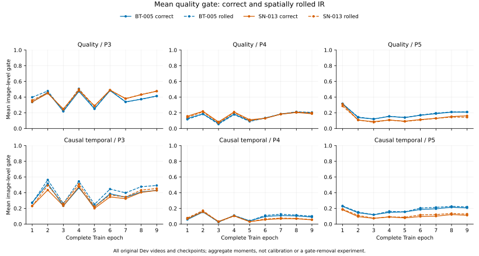
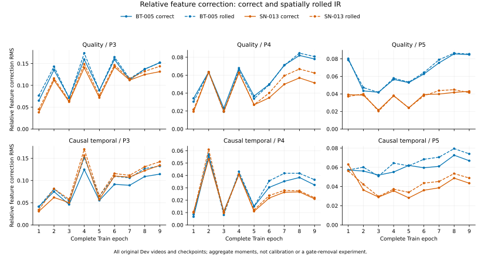

# 九轮完整Dev门控响应诊断

仅使用既有原生产者的保存字段和已完成官方报告，没有新增模型推理、训练、选模或Test结果。90项带门控条件、540条层级记录，432条可用、108条缺失；108个正确IR／roll层级配对只对应36个模型／视频HOTA比较，不能当成108次独立实验。

| 结构 | 层级配对 | 错位后平均门控更高 | 错位后相对修正RMS更高 |
| --- | ---: | ---: | ---: |
| 当前帧质量融合 | 54 | 27 | 33 |
| 时序融合 | 54 | 49 | 47 |
| 全部 | 108 | 76 | 80 |

其余32个配对平均门控更低。36个模型／视频比较中，正确IR HOTA更高20个、更低16个，负值完整保留。原保护掩码记录中受保护特征单元均未改变；这不代表全部检测框或身份不变。覆盖率统计是特征单元观察次数，不是目标或像素级可靠性标注。

这些统计说明当前门控没有表现出“错位时总会减弱”的规律。保存的均值与RMS不足以计算逐像素校准曲线、AUROC或独立模块贡献。该诊断不增加创新计数，不证明伪红外无效。当前按用户最新要求，优先测量相对原始RGB baseline的整体收益。

[完整JSON](PERCEPTUAL_MFT_20261126_NATIVE_STAGE9_DEV_GATE_DIAGNOSIS.json)、[全部层级CSV](perceptual_20261126_native_stage9_dev_gate_diagnosis/all_complete_Dev_gate_levels.csv)、[全部配对CSV](perceptual_20261126_native_stage9_dev_gate_diagnosis/all_paired_normal_vs_roll.csv)。四份producer字段包是原保存字段的精确提取，包本身按字节复制；它们不是完整producer文件的字节副本。完整原始生产者另保存在九轮审计原件目录。图元数据中的PNG路径指向本地预览，PNG未推送。
