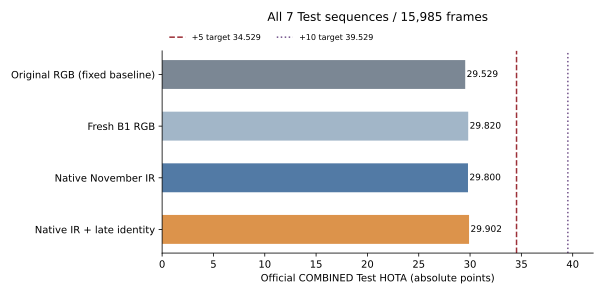
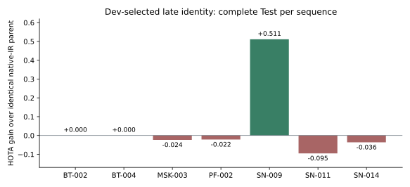

# 当前冻结方案完整Test：+0.373 HOTA，目标仍未达到

固定原始RGB-only YOLOX-X＋ByteTrack完整Test **29.528971**，Dev预选IR加身份续接 **29.902175**，提升 **+0.373204个绝对HOTA点**。最低目标34.528971，还差4.626796点；进一步目标39.528971。没有达到+5或+10。

| 完整Test条件 | HOTA | 对原始RGB | DetA | AssA | IDF1 | MOTA | IDSW |
|---|---:|---:|---:|---:|---:|---:|---:|
| Original RGB (fixed baseline) | 29.528971 | +0.000000 | 46.186593 | 18.967548 | 33.072407 | 50.898476 | 450 |
| Fresh B1 RGB | 29.820430 | +0.291459 | 46.198493 | 19.339960 | 33.094038 | 50.871563 | 449 |
| Native November IR | 29.799525 | +0.270555 | 46.542873 | 19.163110 | 32.662720 | 51.108259 | 487 |
| Native IR + late identity | 29.902175 | +0.373204 | 46.542090 | 19.299047 | 32.746714 | 51.111019 | 483 |

身份续接相对同IR视觉父模型只有+0.102649点，相对补充fresh B1 RGB为+0.081745。原始RGB仍是用户固定的主基线。Dev上的+0.314156不能与Test的+0.270555相加。相对原始RGB，HOTA正向，但IDF1仍低0.325693点，IDSW多33，不宣称所有指标均提高。

身份续接对同IR父模型的逐视频为1正、4负、2相同，主要正向集中SN-009；没有按视频选型或删除负序列。25帧方案实际输出框、分数和顺序保留，只改首次输出身份，身份相关的HOTA匹配及其汇总可能随之变化。

全程固定新版11月DiffV2IR、seed0、原YOLOX-X父模型，物理4/5最多两卡。相关链27个实验worker实际0，其中完整Test阶段16个；独立Test审计实际0、1880官方字段。完整7段15985帧、全部47字段、原276列CSV、银行/图像/检测包来源和真实MOT核验见[正式Test报告](PERCEPTUAL_MFT_20261127_TRACKLET_R2_FULL_TEST.md)。不上传银行、MOT、图像或权重。

[六项Train运动Q完整Dev](PERCEPTUAL_MFT_20261127_TRAIN_MOTION_PRIOR_FULL_DEV.md)也全部出齐，8个相关worker实际0、1269字段独立审计实际0。四项新Q条件全部明显低于late-only，不追加Test。完整Q提高检测侧DetA，却破坏身份关联；该负结果不删除。下一步按已登记的当前形状/宽高比方案继续，保护原中心与身份连续性；本分析不增加任何新精度。

缓存回放排除编码、检测、图像IO和离线IR生成，不是端到端FPS。历史Test暴露、RGB原预训练见过当前Dev、伪IR由RGB派生等限制继续成立。整体系统差值不等于红外专属贡献。当前+5目标未达，独立贡献计数0，Goal仍active。
