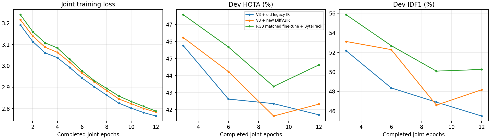

# Pseudo-IR comparison after a matched training-budget extension

Status: **COMPLETE — all three adapted arms trained to 12 joint epochs; final Dev-selected Test evaluations audited.**

The November DiffV2IR input does not establish a tracking improvement under the reproduced V3 fusion and ByteTrack recipe. Its final Test HOTA is 29.195: +0.004 percentage points versus the original RGB checkpoint, -0.543pp versus equally budgeted old IR and -0.334pp versus equally budgeted RGB fine-tuning. The small change against the unadapted original does not establish a benefit from the auxiliary images. All negative results are retained.

The baseline is the preserved RGB YOLOX fish detector plus ByteTrack, not a GRU model. Its initialization SHA256 is `ba211af68a5cc94e0c8e27ed8ec2f48a012f32a3a0feafb8b6e038b725bf7fe0`. The three adapted arms start from that same visible checkpoint; V3 duplicates the visible backbone into both branches and begins with sigmoid gates 0.05. A/B/C identity modules are outside this input comparison and receive no credit for these results.

All Test rows below cover the same seven sequences /15,985 frames, with official TrackEval sequence combination. The adapted arms were each allowed the same 12 joint epochs and selected solely by Dev HOTA; their best checkpoints all occurred at joint 3.

| Method | Selected joint epoch | HOTA | DetA | AssA | IDF1 | MOTA | IDSW |
| --- | ---: | ---: | ---: | ---: | ---: | ---: | ---: |
| Original RGB YOLOX + ByteTrack | 0 | 29.191 | 43.866 | 19.570 | 30.932 | 47.207 | 390 |
| RGB matched fine-tune + ByteTrack | 3 | 29.529 | 46.187 | 18.968 | 33.072 | 50.898 | 450 |
| V3 + old legacy IR + ByteTrack | 3 | 29.738 | 46.595 | 19.068 | 33.736 | 51.667 | 455 |
| V3 + new DiffV2IR + ByteTrack | 3 | 29.195 | 43.916 | 19.487 | 32.678 | 49.603 | 383 |

New DiffV2IR minus each control (percentage points, except IDSW count):

| Control | HOTA | DetA | AssA | IDF1 | MOTA | IDSW |
| --- | ---: | ---: | ---: | ---: | ---: | ---: |
| Original RGB YOLOX + ByteTrack | +0.004 | +0.050 | -0.083 | +1.746 | +2.396 | -7 |
| V3 + old legacy IR + ByteTrack | -0.543 | -2.679 | +0.419 | -1.058 | -2.064 | -72 |
| RGB matched fine-tune + ByteTrack | -0.334 | -2.271 | +0.519 | -0.394 | -1.295 | -67 |

IDF1 and MOTA improve against the original unadapted RGB checkpoint, but both remain below the matched old-IR and RGB controls. New IR has 72 fewer switches than old IR while also producing 9,105 fewer track detections and 6,084 additional misses. That tradeoff must not be reported as unqualified association improvement.

The preserved historical V3 checkpoint was also replayed with the same current evaluation settings. Its different training history and historical normalization make it a secondary reference rather than a matched-input ablation:

| Historical frozen V3 | HOTA | DetA | AssA | IDF1 | MOTA | IDSW |
| --- | ---: | ---: | ---: | ---: | ---: | ---: |
| dev | 46.091 | 70.212 | 30.276 | 52.621 | 92.011 | 106 |
| test | 30.551 | 48.513 | 19.336 | 33.676 | 51.957 | 504 |

The fresh historical Test HOTA 30.551 is stronger than the three current selected adaptations. Earlier historical Test 31.091 is not substituted for this new replay.

The training-adequacy check is complete. The initial six paired epochs were three IR-only calibration epochs plus only three joint detector epochs, starting from pretrained RGB weights. Each paired arm subsequently completed 12 joint epochs /15 total epochs; RGB completed 12 joint epochs /12 total epochs. Every full epoch used all 27,251 Train frames. Thus each RGB/head received 327,012 joint frame exposures; each paired model additionally received 81,753 calibration exposures. The selected joint 3 weights do not mean that training stopped at three joint epochs.

| Arm | Dev HOTA at joint 3 | Joint6 | Joint9 | Joint12 | Train loss at joint 3 | Joint12 | Selected joint epoch |
| --- | ---: | ---: | ---: | ---: | ---: | ---: | ---: |
| V3 + old legacy IR + ByteTrack | 45.764 | 42.613 | 42.345 | 41.689 | 3.061076 | 2.765324 | 3 |
| V3 + new DiffV2IR + ByteTrack | 46.236 | 44.233 | 41.617 | 42.314 | 3.087354 | 2.783097 | 3 |
| RGB matched fine-tune + ByteTrack | 47.579 | 45.679 | 43.356 | 44.621 | 3.107883 | 2.787986 | 3 |



All three training losses continue downward, but none of the later Dev checkpoints exceeds joint 3. New-IR HOTA rebounds from joint 9 to joint 12 without setting a new best. Under the predeclared rule, each arm's best HOTA through joint 12 minus its best through joint 6 is 0.000pp. All arms therefore stop together at joint 12; the conditional 18/24-epoch extension is not triggered. This is validation-based early stopping within this recipe, not proof of a global optimization optimum or of what a different learning-rate schedule would achieve.

Highest Dev HOTA selects the checkpoint, with earlier epochs breaking ties. Final selected Test was replayed once per arm after the stopping decision. Since all selected points are the original joint 3 checkpoints, the final results equal the short-budget scores. This was checked directly: all three final replays reproduce the saved short-run frame IDs, offsets, boxes and scores bit for bit across all seven Test sequences. Their full official TrackEval outputs also match exactly; no old score was substituted for a fresh replay.

The full machine-readable results, every Dev checkpoint, every Test sequence, detection components and deltas are in [RESULTS.json](PSEUDO_IR_BUDGET_EXTENSION_20261121_RESULTS.json), [tables](PSEUDO_IR_BUDGET_EXTENSION_20261121_TABLES.md) and [curve CSV](PSEUDO_IR_BUDGET_EXTENSION_20261121_CURVES.csv). Supplementary DetRe/DetPr/LocA average HOTA IoU thresholds; CLEAR precision/recall use IoU 0.5 on tracker outputs. These are not raw detector COCO AP. The largest new-versus-old short/selected Test loss is the 49-fish MSK-003 scene: HOTA -8.503pp and DetA -13.883pp. All seven sequence differences are retained instead of reporting only the three sequences that improve.

The frozen [short plan](../../configs/pseudo_ir_comparison_20261120.json) and [budget-extension plan](../../configs/pseudo_ir_budget_extension_20261121.json) record what outcomes had already been seen when each plan was fixed. Extension commit `daced61` predates extended training and completion of the short new-input Test. The visible source historically saw all eight original Train videos, including the current Dev videos. New adaptation uses only the six Train videos; Dev contains BT-005/SN-013 and Test contains all seven frozen historical sequences. Historical Test had participated in earlier tuning and generation-configuration probes, so these results are a frozen diagnostic rather than a new blind benchmark.

New input is the existing November fixed-caption DiffV2IR grayscale PNG, repeated to three channels without an INFERNO colour map. It is not regenerated. The old causal-cache directories contained no frame files at execution audit; the explicitly frozen old-input amendment uses the physically present archived `infrared/*.jpg` files. Missing new images raise an error rather than substituting another version. Normalization is fitted only on the 27,251 Train frames: new scalar mean 0.318765696840321/std 0.11454358863241268, repeated3; old RGB-order means [0.07301626087164649,0.03020227263580627,0.05919517621276643] and std [0.21281907207233852,0.11548947582450884,0.11228541704390677].

The preserved generator audit found current-RGB conditioning, automatic SAM union masks and a fixed caption. Its inspected implementation does not pass GT boxes/masks as SAM prompts. Six source hashes and two metadata examples are in [the generation provenance](PSEUDO_IR_GENERATION_PROVENANCE_20261120.json); this is not an independent regeneration audit of all 48,070 outputs. RGB-derived pseudo IR does not establish independent-sensor thermal information.

Training uses 480x864, batch 8/accumulation 1, SGD momentum 0.9/Nesterov/weight decay 0.0005, shared horizontal flip 0.5, fixed pretrained BN running statistics, EMA and seed 0. The first 3 joint epochs preserve the original effective learning rates 0.000025/0.000020/0.000010. Continuation explicitly warm-restarts joint 4–12 at 0.000025 with a nine-epoch cosine segment/floor0.2; it is not relabeled as a from-scratch12-epoch cosine run. Conditional segments 13–18 and 19–24 were planned but not executed. Old/new share loader seed and phase counts. RGB matches RGB/head epochs and augmentation policy, but its lack of auxiliary calibration means minibatch ordering and EMA update history are not identical to the paired arms. Single-seed results do not establish seed-independent superiority.

Evaluation is fixed at 800x1440, batch 4/FP16, confidence 0.1, NMS 0.7, ByteTrack threshold 0.6/buffer 30/match 0.9/frame-rate 25/minimum area100, with the same protocol-derived GT and official TrackEval. Test does not select training length, weights or thresholds. Recorded replay FPS includes batched detection and sequential tracking on precomputed auxiliary images; it excludes image generation and is not controlled single-frame online latency.

Only physical GPUs 2/3 were used. Every executed training event and evaluation records its physical device. Complete raw-checkpoint auditing verifies 15/15/12 epochs, full epoch coverage, unchanged prefixes, planned piecewise LRs, optimizer momentum, all five RNG groups, finite raw/EMA tensors and successful EMA-update counts after logged AMP skips. [Validation](PSEUDO_IR_BUDGET_EXTENSION_20261121_VALIDATION.json), [final runtime audit](PSEUDO_IR_FINAL_RUNTIME_AUDIT_20261121.json), [full-Test replay equivalence](PSEUDO_IR_SELECTED_TEST_REPLAY_EQUIVALENCE_20261121.json), [requirements audit](PSEUDO_IR_BUDGET_EXTENSION_20261121_FINAL_AUDIT.json) and the 19-passing-test local suite provide the checks.

The first short RGB Test and reference Test attempts were interrupted during legacy terminal cleanup and were replayed in independent OS sessions. They were never counted as complete. [The execution audit](PSEUDO_IR_COMPARISON_20261120_EXECUTION_AUDIT.json) preserves that recovery. The uninterrupted budget-extension campaign ran from 01:53 to 08:35 CST on 2026-11-21.

Storage is bounded: one atomic full latest and one compact best EMA per adapted arm, about 6.2 GiB locally, without an epoch-snapshot series. Completed short full checkpoints were moved to a byte-verified NAS archive with original-path symlinks, releasing 5.276 GiB; [the archive audit](PSEUDO_IR_CHECKPOINT_ARCHIVE_20261121.json) retains every original checksum. The 7.22 GiB Train-only tmpfs byte cache was removed after completion at 08:35 CST. Original NAS images remain intact. Launcher logs observed at least 58.07 GiB local free space, above the 40 GiB reserve. No training/inference worker remains from this campaign. Large checkpoints, images, detection caches and tracks stay outside Git; only lightweight code, configuration, figures and reports are committed.

The final export command, using the recorded evaluation Python environment, is:

```bash
/data3/liuyeqiang/.venvs/trackocd-a100/bin/python tools/summarize_pseudo_ir_extension.py \
  --plan configs/pseudo_ir_budget_extension_20261121.json \
  --output-json docs/fusion_research/PSEUDO_IR_BUDGET_EXTENSION_20261121_RESULTS.json \
  --output-markdown docs/fusion_research/PSEUDO_IR_BUDGET_EXTENSION_20261121_TABLES.md \
  --curve-csv docs/fusion_research/PSEUDO_IR_BUDGET_EXTENSION_20261121_CURVES.csv \
  --curve-png docs/fusion_research/PSEUDO_IR_BUDGET_EXTENSION_20261121_CURVES.png \
  --require-complete
```

The shared runtime used `OPENBLAS_NUM_THREADS=1 OMP_NUM_THREADS=2 MKL_NUM_THREADS=2` and the repository, `exps`, `.codex/pydeps`, CFP-FishMOT Python site-packages and HybridSORT reference roots on `PYTHONPATH`. Full commands and source hashes are retained in the result manifests.
