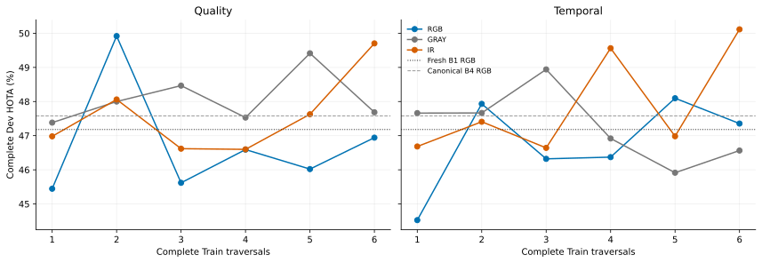
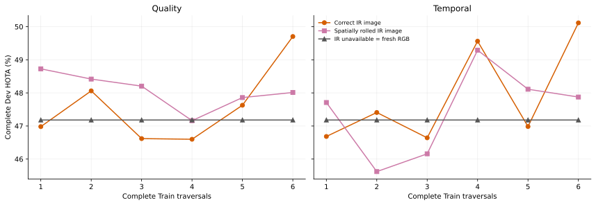
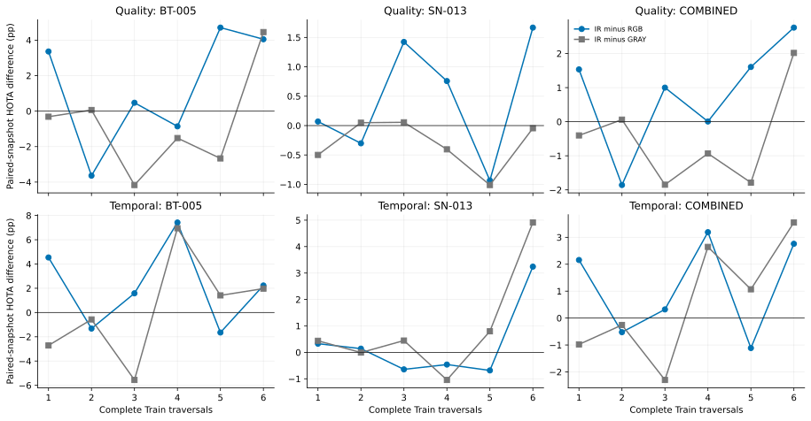

# Native pyramid: minimum-six-epoch complete Dev

All62 registered cases; both complete Dev videos,4834 frames. These views do not change the original 6/9/12 budget decision or final selection and do not establish Test gains or independent innovations.

All36 normal complete-Dev checkpoints. Full-precision combined CSV values, not an average of video scores. The original budget decision uses its registered rounded39-field summaries.

Both IR modes at all six epochs, including wrong-image and unavailable-image controls. Unavailable curves are byte-checked against fresh RGB in the source audit; no favorable snapshot is omitted.

Same-mode, same-epoch IR-minus-RGB and IR-minus-gray differences for each full Dev video and the official combined result. Videos/checkpoints are not independent repetitions; no confidence interval or significance claim is made. These comparisons are not single-module ablations.

Full precision plotted values are retained in `plotted_complete_Dev_points.csv`; all raw276-column official CSV bindings and input hashes are retained in `figure_sources.json`. Historical Test exposure, RGB pretraining seeing Dev and RGB-derived pseudoIR remain disclosed.
