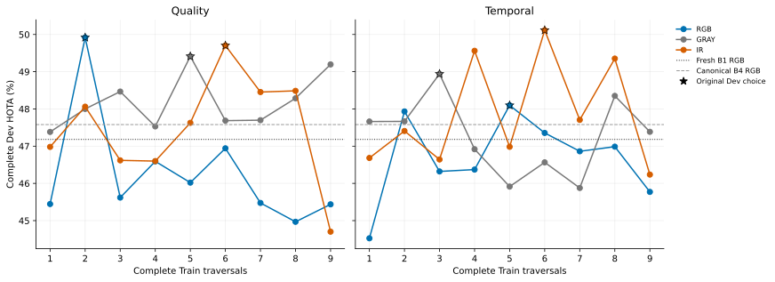
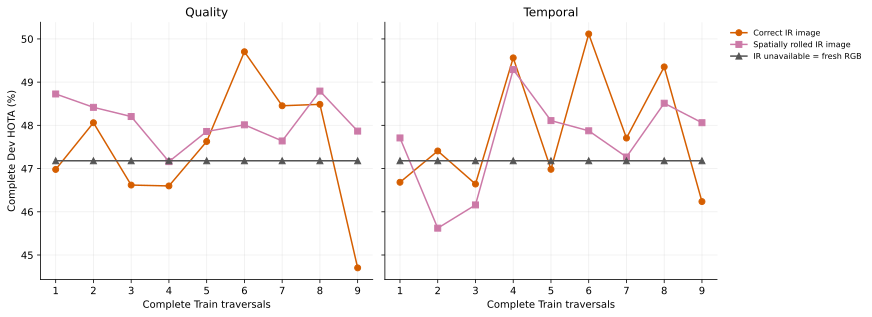
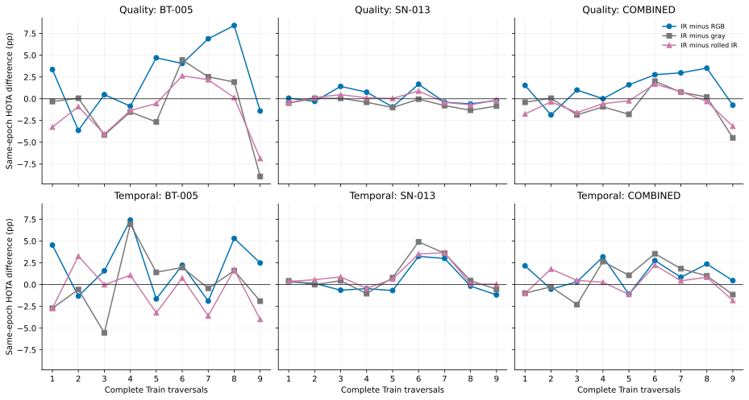

# 九轮完整Dev曲线

两段完整Dev视频共4834帧。星号为原规则在各组选择的最佳检查点，不建立新的全局选模规则。所有轮次、正负值均保留；两个视频和各检查点不是独立随机重复。

图依据原92条件的276行视频／汇总点，重新核对12972个原始官方字段。原始276列CSV仍为数值来源；图中没有用两视频均值替代官方汇总。SVG与绘图点表逐字节保留，五张最终PNG预览已检查，PNG仅留本地。完整图例放在坐标外；第一次渲染与最终渲染的绘图CSV逐字节相同。

[完整指标](../PERCEPTUAL_MFT_20261126_NATIVE_STAGE9_FULL_DEV.json)、[中文分析](../PERCEPTUAL_MFT_20261126_NATIVE_STAGE9_FULL_DEV_ANALYSIS_ZH.md)。当前优先目标是对原始RGB baseline的正式Test增益，额外RGB结构对照不再是当前验收门槛。
